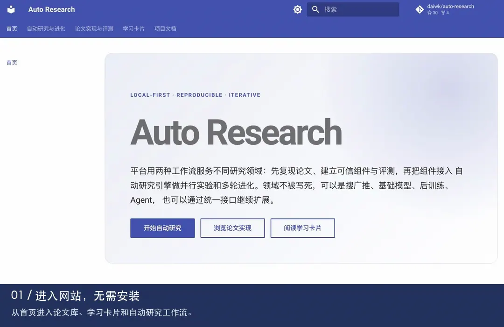

# Auto Research

读懂论文，查验实现，再用公开数据做研究迭代。覆盖搜广推、基础模型、LLM 后训练、Agent、多模态与结构化决策。

[](https://github.com/daiwk/auto-research/actions/workflows/quality.yml)
[](https://github.com/daiwk/auto-research/actions/workflows/docs.yml)

**[打开网站](https://daiwk.github.io/auto-research/) · [逐篇学习](https://daiwk.github.io/auto-research/learning/) · [论文库](https://daiwk.github.io/auto-research/research-library/) · [实验看板](https://daiwk.github.io/auto-research/public-experiment-dashboard/)**

## 先看一遍网站

不用安装，直接在网站里查论文、按主题学习、展开问答和核对实验。下面的动画使用实际网站画面，完整演示不到一分钟。

<picture>
  <source media="(prefers-reduced-motion: reduce)" srcset="docs/assets/media/site-tour-poster.webp">
  
</picture>

[观看可暂停的 MP4](docs/assets/media/site-tour.mp4) · [演示内容与制作方式](docs/assets/media/README.md)

## 你可以用它做什么

| 想做的事 | 入口 | 能看到什么 |
|---|---|---|
| 找到相关论文 | [论文实现与评测](https://daiwk.github.io/auto-research/research-library/) | 按领域、机构、主题和时间浏览，查看中文解读、公式与代码 |
| 分层读懂一篇 | [学习卡片](https://daiwk.github.io/auto-research/learning/) | 基础理解 → 核心机制 → 方法对比 → 实现细节；答案、例子和来源按需展开 |
| 接着上次读 | [最近新增问题](https://daiwk.github.io/auto-research/learning/recent/) | 新论文和旧论文补充的问题统一汇总，可筛选主题与学习层次 |
| 判断实验说明了什么 | [公开实验看板](https://daiwk.github.io/auto-research/public-experiment-dashboard/) | 对照数据、基线、指标、seed 和验证层级，保留负结果及未复现边界 |
| 亲自运行研究 | [自动研究与进化](docs/auto-research.md) | 执行已实现的论文组件，用 validation 选择候选，再运行隔离 test |

仓库目前注册 **410 个**论文 adapter。收录论文、机制诊断与完整能力复现分别标注，具体状态以各篇证据为准。

## 在本地开始

只阅读网站无需安装。运行 CLI 需要 macOS/Linux、Python 3.11+：

```bash
git clone https://github.com/daiwk/auto-research.git
cd auto-research
python3 -m venv .venv
source .venv/bin/activate
python -m pip install -e .
auto-research --help
auto-research list
```

需要训练依赖、公开数据或平台 Demo 时，继续看[安装与 Demo](readme_setup.md)；模型和数据会按所选任务下载，默认复用本地缓存。

## 按需要深入

| 文档 | 内容 |
|---|---|
| [安装、数据与 Demo](readme_setup.md) | 可选依赖、Mac/MPS、Linux CPU/CUDA、数据准备和一键示例 |
| [实验与自动研究](readme_experiments.md) | 单篇/批量复现、模型进化、Topic research、外部实验接入 |
| [开发与证据约定](readme_development.md) | 代码结构、扩展方式、测试、PR 与实验解释边界 |
| [交付与审计记录](readme_updates.md) | 历史批次、已验证结果、失败与未完成范围 |
| [架构与扩展](docs/architecture.md) | adapter、数据隔离、保真度和评测合同 |
| [文档维护](docs/getting-started.md) | 本地预览、问答编写、生成与发布 |

## 参与和维护

欢迎提交问题、修正文档或新增论文组件：[Issues](https://github.com/daiwk/auto-research/issues) · [提交历史](https://github.com/daiwk/auto-research/commits/main/)。使用编码助手时先读 [AGENTS.md](AGENTS.md)。

Python 契约与文档构建由 CI 检查；新论文需要同步信息、源码/成本边界及四层问答。实验保留命令、版本、指标和失败记录；需要 CUDA 的新实现还必须提供实际 GPU 验证证据。

<details>
<summary>Star History</summary>

<a href="https://www.star-history.com/?repos=daiwk%2Fauto-research&type=date&legend=top-left">
 <picture>
   <source media="(prefers-color-scheme: dark)" srcset="https://api.star-history.com/chart?repos=daiwk/auto-research&type=date&theme=dark&legend=top-left" />
   <source media="(prefers-color-scheme: light)" srcset="https://api.star-history.com/chart?repos=daiwk/auto-research&type=date&legend=top-left" />
   
 </picture>
</a>

</details>
