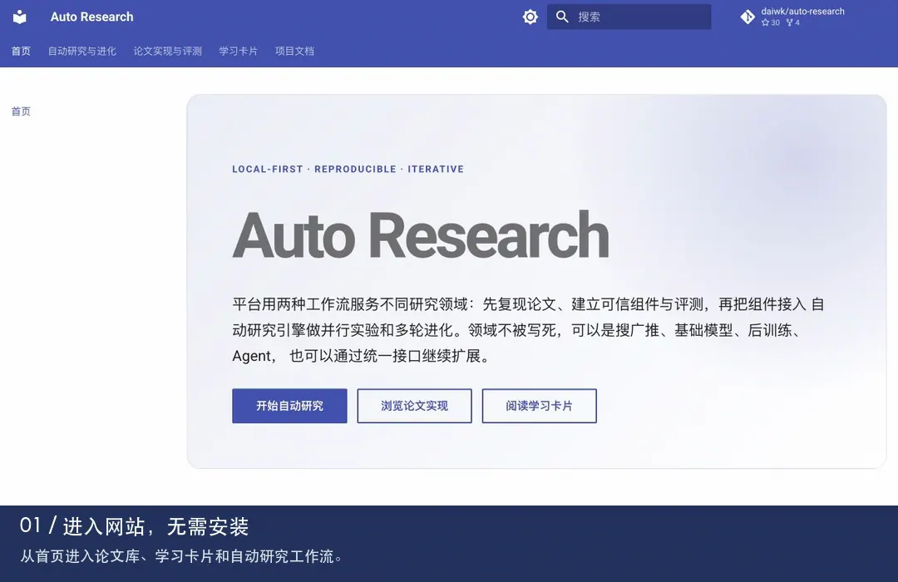

# Auto Research：410+ 前沿 AI 论文代码实现、公开实验审计与自动进化平台

简体中文 · [English README](README.en.md) · [English documentation](docs/en/index.md)

> **不止于“读论文”，更用代码和真实数据检验论文。**  
> 覆盖 **搜广推（搜索/广告/推荐）、基础模型、LLM 后训练、Agent、多模态与结构化决策** 六大领域。集齐 **410+ 篇前沿论文的标准化代码 Adapter、四层递进精读问答、跨论文机制对比、多 Seed 公开数据实验看板（保留负结果）** 与 **多代模型自动进化框架**。

[](https://github.com/daiwk/auto-research/actions/workflows/quality.yml)
[](https://github.com/daiwk/auto-research/actions/workflows/docs.yml)

🌐 **[打开在线网站](https://daiwk.github.io/auto-research/) · [论文实现与评测库 (410+)](https://daiwk.github.io/auto-research/research-library/) · [四层学习卡片](https://daiwk.github.io/auto-research/learning/) · [跨论文专题精读](https://daiwk.github.io/auto-research/learning/deep-dives/) · [公开实验看板](https://daiwk.github.io/auto-research/public-experiment-dashboard/)**

⭐ *如果你经常在线查阅本站的论文精读卡片、代码实现或实验对照结论，欢迎给本仓库点一个 **Star**，方便随时找回最新更新！*

---

## 为什么做 Auto Research？（核心特色）

1. **拒绝“伪复现”，严格标注代码保真度（Fidelity Tiers）**：仓库目前已注册 **410 个**论文 Adapter。严格区分完整训练链路（`full_pipeline`）、核心算法机制（`core_mechanism`）与启发式概念演示（`concept_demo`），绝不用简单的先验加权或代理打分冒充论文复现。
2. **工业界 A/B 证据审计 & 保留负结果**：搜广推工业论文强制梳理真实生产流量与线上 A/B 指标；本地公开数据实验采用 L0–L3 分级评测与多 Seed 统计（少于 3 个 Seed 仅标为 smoke，禁止宣称稳定提升），**如实保留负向结果与未复现边界**。
3. **四层问答 + 跨论文专题精读（Deep Dives）**：每篇论文拆解为「基础理解 → 核心机制 → 方法对比 → 实现细节」四层交互卡片；按主题横向对比多篇论文的机制取舍，新论文入库时自动校验并增量更新专题卡片。
4. **安全可控的多代模型自动进化（`evolve` & `run`）**：在推荐（RankMixer / HyFormer / GenRec）、`micro-llm`（架构 / 数据配比 / SFT / GRPO）与 Agent 领域，基于已验证的白名单论文算子进行多代遗传进化；严格在 validation 上做晋级选择，最后在隔离的 test 集上做终评。

---

## 先看一遍网站（无需安装，开箱即读）

不用配环境，直接在在线网站里检索论文、按主题精读、展开四层问答和核对实验数据。下面的动画使用实际网站画面，完整演示不到一分钟：

<picture>
  <source media="(prefers-reduced-motion: reduce)" srcset="docs/assets/media/site-tour-poster.webp">
  
</picture>

[观看可暂停的 MP4](docs/assets/media/site-tour.mp4) · [演示内容与制作方式](docs/assets/media/README.md)

## 你可以用它做什么

| 想做的事 | 入口 | 能看到什么 |
|---|---|---|
| 找到相关论文与代码 | [论文实现与评测](https://daiwk.github.io/auto-research/research-library/) | 按领域、机构（Google/Meta/字节/快手/美团/阿里等）、主题和时间浏览，查看中文解读、架构图、公式与本地代码映射 |
| 分层读懂一篇论文 | [学习卡片](https://daiwk.github.io/auto-research/learning/) | 基础理解 → 核心机制 → 方法对比 → 实现细节；答案、教学例子和原文来源按需展开 |
| 横向比较同一主题的多篇论文 | [专题精读](https://daiwk.github.io/auto-research/learning/deep-dives/) | 机制对照、工程取舍分析与跨论文问答；新论文加入后增量更新对应卡片 |
| 接着上次的进度读 | [最近新增问题](https://daiwk.github.io/auto-research/learning/recent/) | 新论文和旧论文补充的问题统一汇总，可按主题与学习层次筛选 |
| 查验真实实验效果与边界 | [公开实验看板](https://daiwk.github.io/auto-research/public-experiment-dashboard/) | 对照数据集、基线、指标、seed 统计和 L0–L3 验证层级，如实保留负结果及未复现边界 |
| 在本地运行复现与自动进化 | [自动研究与进化](docs/auto-research.md) | 运行已实现的论文组件（`reproduce`），或用 validation 进化选择候选模型并运行隔离 test（`evolve`） |

仓库目前注册 **410 个**论文 adapter。收录论文、机制诊断与完整能力复现分别标注，具体状态以各篇证据为准。

## 在本地开始

只阅读网站无需安装。运行本地 CLI 需要 macOS/Linux、Python 3.11+：

```bash
git clone https://github.com/daiwk/auto-research.git
cd auto-research
python3 -m venv .venv
source .venv/bin/activate
python -m pip install -e .
auto-research --help
auto-research list
