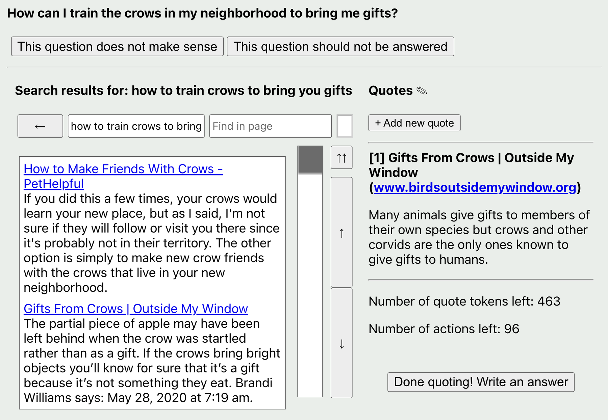

# WebGPT: browser-assisted question answering with citation constraints

<!-- source-sha256: 62d36b0afa0c39f764b6d4ab646e48b4e26741ae83442f896ac338291f20ec46 -->

[简体中文](README.md)

> Implements text-browser trajectories, citations, and reward-model rejection sampling. The local deterministic tool environment is not live internet browsing.

## Paper information

| Field | Details |
|---|---|
| Paper | [WebGPT](https://arxiv.org/abs/2112.09332) |
| Organization | OpenAI |
| First public release | 2021-12-17 |
| Authors' code | Full training code was not released. The [WebGPT comparisons dataset](https://huggingface.co/datasets/openai/webgpt_comparisons) is public. |
| Adapter / method | `webgpt` |
| Local reproduction code | `src/auto_research/agent_research/` |

## Original paper

### Motivation and method

Long-form QA can hallucinate and makes evidence difficult to check. WebGPT searches, clicks, and scrolls in a text browser and collects citations for answers. It first trains with behavior cloning, then uses a human-preference reward model to reject-sample among browser and answer trajectories.


<!-- paper-figure:start -->
### Key figure from the paper

[](https://ar5iv.labs.arxiv.org/html/2112.09332/assets/images/demo_website.png)

> **Figure 1:** Overview of the paper's method and key components. From the [original paper](https://arxiv.org/abs/2112.09332); copyright remains with the authors.
<!-- paper-figure:end -->

### Core equations

$$
\tau^\star=\arg\max_{\tau_i\sim\pi_\theta}
r_\phi(x,\tau_i),\qquad
\tau=(a_1,o_1,\ldots,a_T,o_T,y,\mathcal C).
$$

### Paper results

175B best-of-64 answers win 56% against human demonstrations and 69% against top-voted Reddit answers in human evaluation. TruthfulQA is 75% true and 54% true and informative. No production online A/B is reported.

## Local reproduction

ScaleMCP mini, 120 episodes, seed 42: generate two tool trajectories per task and select by evidence coverage.

| Metric | Long-context baseline | WebGPT |
|---|---:|---:|
| Joint success | 1.0000 | 1.0000 |
| Average cost | 64.5000 | **3.0000** |
| References / candidates | 0 / 0 | 600 / 240 |

```bash
auto-research agent-eval --method webgpt --benchmark scalemcp-mini \
  --episodes 120 --memory-size 24 --seed 42
```

See the [stable metrics](../../experiments/p1-agent-candidates-mini-suites-seed42.json).

## Reproduction boundaries

Retains browser actions, citation constraints, and trajectory rejection sampling, but no live pages, GPT-3 or reward-model training, or ELI5 human evaluation.
