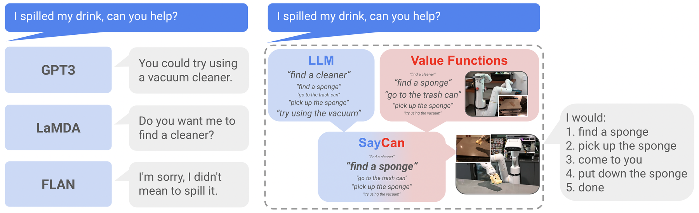

# SayCan: Plan with language relevance and executable affordances

<!-- source-sha256: 6ce47818ff2ecaf85f53ac855302a22a5636703edae44a9c8f911064e80e7747 -->

[简体中文](README.md)

> Deterministic skill and affordance mini-suite, not physical robot control.

## Paper information

| Field | Details |
|---|---|
| Paper | [Paper or original source](https://arxiv.org/abs/2204.01691) |
| Institution | Robotics at Google / Everyday Robots. |
| First public release | 2022-04-04 |
| Author code | [Simulated tabletop implementation](https://github.com/google-research/google-research/tree/master/saycan). |
| Local adapter or method key | `saycan` |
| Local reproduction code | `src/auto_research/agent_research/` |

## Paper method and evidence

Score each pretrained skill by language relevance and value-function affordance. Execute the best product and append the action to context before replanning.


<!-- paper-figure:start -->
### Original paper figure

[](https://ar5iv.labs.arxiv.org/html/2204.01691/assets/figures/intro.png)

Figure shows language and affordance combination. From the [original paper](https://arxiv.org/abs/2204.01691); copyright remains with the authors.
<!-- paper-figure:end -->

### Core equation

$$
\pi(s\mid i,h,e)\propto
p_{\mathrm{LM}}(s\mid i,h)\,
p_{\mathrm{aff}}(\mathrm{success}\mid s,e).
$$

### Reported results

On 101 physical-robot tasks, PaLM-SayCan scores 84% planning and 74% execution success; FLAN-SayCan 70% and 61%. Not production A/B.

## Local reproduction

PlanBench mini, 120 episodes, seed 42: baseline/SayCan joint success **1.0000/1.0000**, mean cost **64.5000/3.3750**, affordance checks **0/1350**, infeasible filtered **0/790**.

```bash
auto-research agent-eval --method saycan --benchmark planbench-mini \
  --episodes 120 --memory-size 24 --seed 42
```

[Stable metrics](../../experiments/p1-agent-candidates-mini-suites-seed42.json). Deterministic executable skills, no vision, control policy or value-function training.
