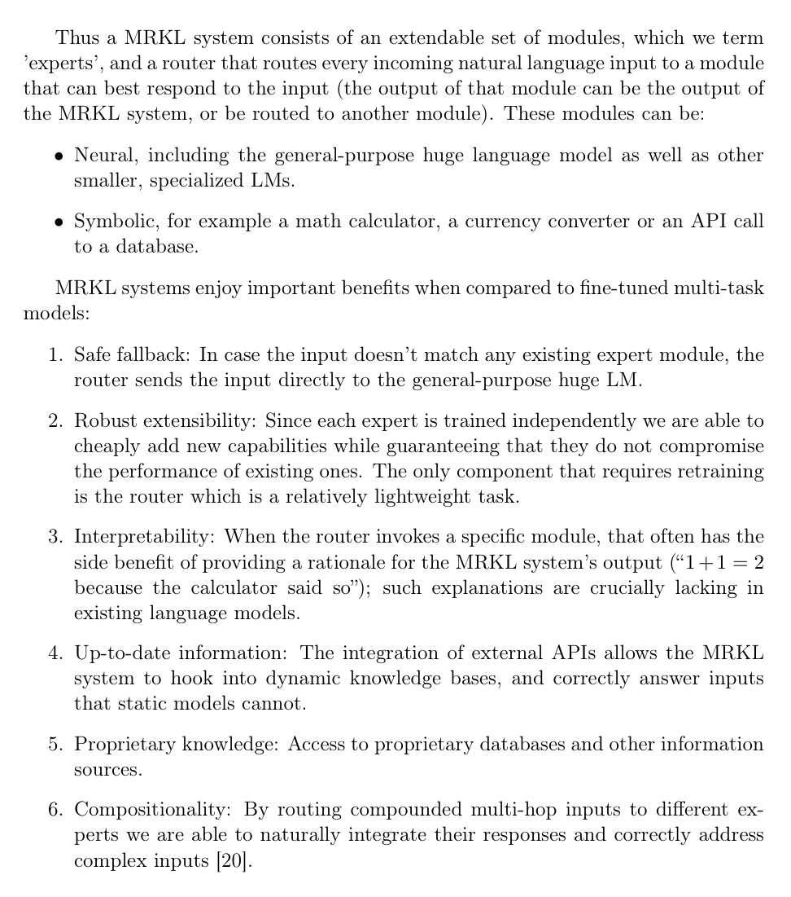

# MRKL Systems: Modular neuro-symbolic agents

<!-- source-sha256: 6245a66957df9a8d3f5a509373bff7cdafda9e5e0f2230dccfb046b41ac5685b -->

[简体中文](README.md)

> Explicit routing, expert registry and aggregation, not a single prompt returning the correct tools.

## Paper information

| Field | Details |
|---|---|
| Paper | [Paper or original source](https://arxiv.org/abs/2205.00445) |
| Institution | AI21 Labs / Hebrew University / Technion / University of British Columbia. |
| First public release | 2022-05-01 |
| Author code | The complete Jurassic-X/MRKL implementation was not released. |
| Local adapter or method key | `mrkl` |
| Local reproduction code | `src/auto_research/agent_research/` |

## Paper method and evidence

Route inputs to neural or discrete experts such as knowledge bases and calculators. Discrete modules provide deterministic computation; the LM handles language understanding and the interface. The contribution is routing and modular boundaries, not a new LM loss.


<!-- paper-figure:start -->
### Original paper figure

[](https://arxiv.org/pdf/2205.00445#page=4)

The original figure shows modular routing. From the [original paper](https://arxiv.org/abs/2205.00445); copyright remains with the authors.
<!-- paper-figure:end -->

### Core equation

$$
m^\star=\arg\max_{m\in\mathcal M}p_\phi(m\mid x),\qquad
\hat y=f_{m^\star}(x).
$$

### Reported results

Jurassic-X cases illustrate controllability on computation and fresh knowledge; no reproducible production A/B or unified offline benchmark table.

## Local reproduction

ScaleMCP mini, 120 episodes, seed 42. Route calculators, calendars, maps, weather, databases and tables to discrete experts. Baseline/MRKL joint success **1.0000/1.0000**, mean cost **64.5000/1.2500**, router/symbolic calls **0/0 vs 360/170**. [Metrics](../../experiments/p0-missing-agent-mini-suites-seed42.json). No Jurassic-X, live search or private KB; cost is a common proxy, not latency.

```bash
auto-research agent-eval --method mrkl --benchmark scalemcp-mini \
  --episodes 120 --memory-size 24 --seed 42
```
