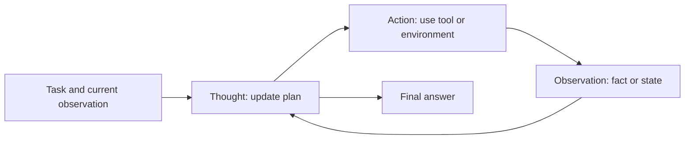
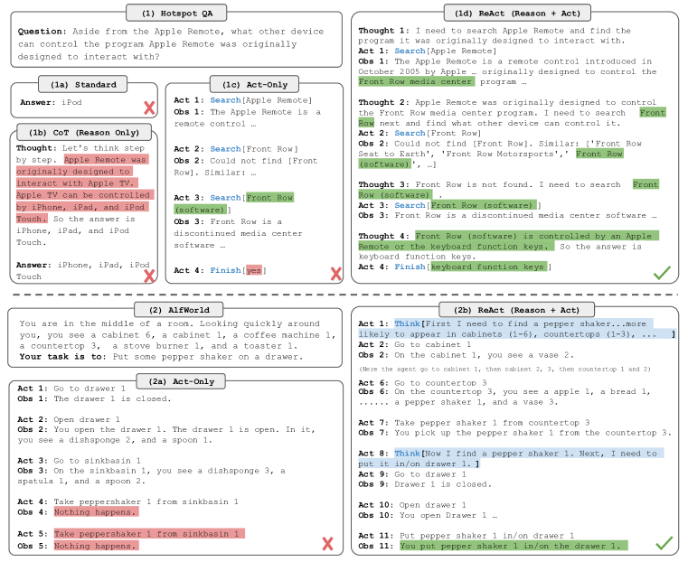

<!-- source-sha256: e356d3e717cb7cf1b6f307cb79728bffd7d3d9807443aa881c22dab763ac518e -->

[简体中文](README.md) · English

# ReAct

> The local implementation alternates Thought → Action → Observation and records actual reasoning steps and actions. It is not a direct answer wrapped as ReAct.

## Paper information

| Field | Details |
| --- | --- |
| Paper | [ReAct: Synergizing Reasoning and Acting in Language Models](https://arxiv.org/abs/2210.03629) |
| Institution | Princeton University / Google Research |
| First public release | 2022-10-06 |
| Author code | [Released](https://github.com/ysymyth/ReAct) |
| Local adapter or method key | `react` |
| Local reproduction code | `src/auto_research/agent_research/` |

## Original paper summary

### Background and main changes

Chain-of-thought alone can hallucinate from closed-book knowledge; action-only agents lack planning and state tracking. ReAct alternates natural-language reasoning with environment actions and adds each observation to the next context. Reasoning can correct errors and actions can obtain external facts.



<!-- paper-figure:start -->
### Key figure from the paper

[](https://ar5iv.labs.arxiv.org/html/2210.03629/assets/x1.png)

> **Figure 1:** Overall design and components. From the [paper](https://arxiv.org/abs/2210.03629); copyright belongs to the authors. Click for the source.
<!-- paper-figure:end -->

### Core equations

$$
\tau=(o_0,t_1,a_1,o_1,\ldots,t_T,a_T,o_T),\qquad
(t_i,a_i)\sim\pi_\theta(\cdot\mid o_{\le i-1},t_{<i},a_{<i}).
$$

The contribution is not a new loss; it puts the reasoning trace and executable actions in one trajectory.

### Offline and online results

The paper improves success over imitation/RL baselines by 34 and 10 percentage points on ALFWorld and WebShop, respectively. It uses the Wikipedia API to reduce hallucination on HotpotQA and FEVER. No production online A/B test is reported.

## Local reproduction

ScaleMCP mini uses 120 fixed episodes and seed 42. The implementation performs one reasoning step before each required tool, then records the action and observation.

| Metric | ReAct |
|---|---:|
| Joint success | **1.0000** |
| Average cost | 3.0000 |
| Reasoning steps / actions | 360 / 360 |

```bash
auto-research agent-eval --method react --benchmark scalemcp-mini \
  --episodes 120 --memory-size 24 --seed 42
```

Stable metrics: [`classic-agent-mini-suites-seed42.json`](../../experiments/classic-agent-mini-suites-seed42.json).

## Scope

The alternating trace and tool-action counts are retained, but observations come from a deterministic mini-suite. It does not call Wikipedia, WebShop, or a paid LLM. The local 1.0 only verifies the execution loop and is not comparable with the paper's results.

## Unified L2.1 isolated capability result

On the isolated `toolroute-l2.1-v1` test split (60 episodes/seed, seeds 42/43/44), ReAct reaches joint success **0.6833**, plan-step F1 **0.7683**, and failure recovery **0.6667**. The policy interface has no reference answer, plan, or route, and no guide. See [metrics](metrics/toolroute-l2-seeds42-44.json) and the [L2.1 isolated capability protocol](../capability-benchmark.md).
