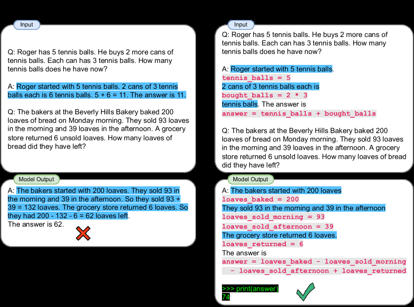

# PAL: Delegate exact reasoning to a program interpreter

<!-- source-sha256: cd12d810aa8770e3e463436b4c3f35adade6196d36794bd345cc8faef155016a -->

[简体中文](README.md)

> Local controlled intermediate programs and interpreter execution, not Codex code generation.

## Paper information

| Field | Details |
|---|---|
| Paper | [PAL](https://arxiv.org/abs/2211.10435) |
| Institution | Carnegie Mellon University / Inspired Cognition. |
| First public release | 2022-11-18 |
| Author code | [reasoning-machines/pal](https://github.com/reasoning-machines/pal). |
| Local adapter or method key | `pal` |
| Local reproduction code | `src/auto_research/agent_research/` |

## Paper method and evidence

LLMs can decompose a task but make arithmetic or symbolic execution mistakes. PAL synthesizes a program with variables and control flow, then uses a deterministic runtime such as Python for exact calculation.


<!-- paper-figure:start -->
### Original paper figure

[](https://ar5iv.labs.arxiv.org/html/2211.10435/assets/x1.png)

The original figure shows the generation/execution boundary. From the [original paper](https://arxiv.org/abs/2211.10435); copyright remains with the authors.
<!-- paper-figure:end -->

### Core equation

$$
z\sim p_\theta(z\mid x,\mathcal D_{\mathrm{demo}}),
\qquad \hat y=\operatorname{Exec}(z).
$$

### Reported results

Across 13 arithmetic, symbolic and algorithmic tasks, Codex+PAL GSM8K top-1 beats PaLM-540B chain-of-thought by 15 percentage points. No production A/B.

## Local reproduction

ScaleMCP mini, 120 episodes, seed 42; construct and execute an actual CALL/RETURN program per item.

| Metric | Long-context baseline | PAL |
|---|---:|---:|
| Joint success | 1.0000 | 1.0000 |
| Mean cost | 64.5000 | 1.4000 |
| Programs / interpreter calls | 0 / 0 | 120 / 120 |

```bash
auto-research agent-eval --method pal --benchmark scalemcp-mini \
  --episodes 120 --memory-size 24 --seed 42
```

[Fixed metrics](../../experiments/p1-agent-candidates-mini-suites-seed42.json). The controlled IR is not arbitrary Python; no Codex calls or paper GSM8K reproduction.
