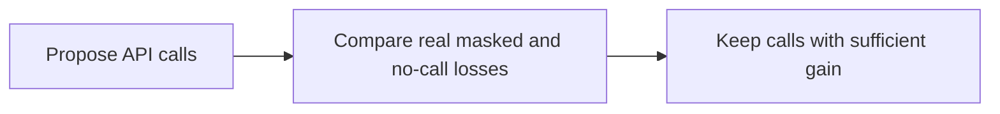
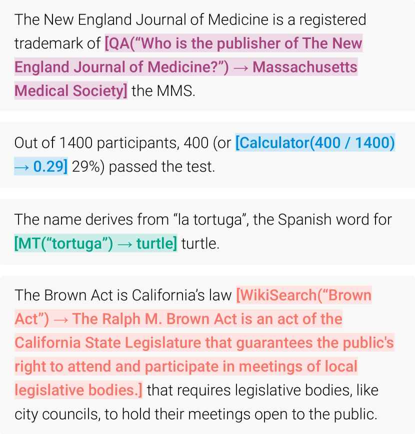

# Toolformer

<!-- source-sha256: 35e99799c56a3d3808016d2ec780ef0bbb6a5249974ca501c521ba793226ac07 -->

[简体中文](README.md)

> Self-supervised candidate generation and no-call/masked-call filtering.

## Paper information

| Field | Details |
|---|---|
| Paper | [Paper or original source](https://arxiv.org/abs/2302.04761) |
| Institution | Meta AI Research / Universitat Pompeu Fabra. |
| First public release | 2023-02-09 |
| Author code | No official training code released; public GitHub implementations are third party. |
| Local adapter or method key | `toolformer` |
| Local reproduction code | `src/auto_research/agent_research/` |

## Paper method and evidence

Sample candidate API calls from few-shot examples. Compare downstream token losses for real tool results, masked results and no call, and keep only helpful calls for continued training.



<!-- paper-figure:start -->
### Original paper figure

[](https://ar5iv.labs.arxiv.org/html/2302.04761/assets/x1.png)

Figure shows candidate filtering by predictive utility. From the [original paper](https://arxiv.org/abs/2302.04761); copyright remains with the authors.
<!-- paper-figure:end -->

### Core equation

$$
L_i(z)= -\sum_{j=i}^{n}\log p(x_j\mid x_{<j},z),\qquad
\Delta_i=L_i(\varnothing)-L_i(\text{API call + result}),
$$

Only calls with $\Delta_i$ above threshold enter training data.

### Reported results

6.7B GPT-J improves on multiple zero-shot tasks over vanilla GPT-J and sometimes exceeds larger GPT-3 while retaining general language modeling. No production A/B.

## Local reproduction

ScaleMCP mini proposes required and distracting calls; only calls reducing loss relative to no-call pass. Joint success **1.0000**, mean cost **3.0000**, candidate/accepted calls **540/360**. [Metrics](../../experiments/classic-agent-mini-suites-seed42.json). Loss is deterministic tool utility, not GPT-J token loss. No 6.7B continued training or five real API classes.

```bash
auto-research agent-eval --method toolformer \
  --benchmark scalemcp-mini --episodes 120 --seed 42
```
