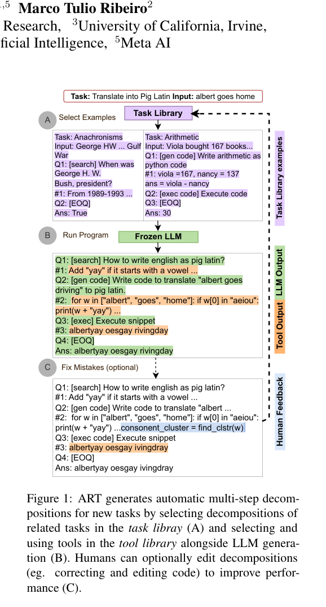

# ART: Automatic multi-step reasoning and tool use

<!-- source-sha256: 881c8bf7fa3fca19fd1fac2e674c59c45e190a8e1f046dc7ed07a97247938390 -->

[简体中文](README.md)

> Task library, program flow, pause/resume and successful-example writeback.

## Paper information

| Field | Details |
|---|---|
| Paper | [Paper or original source](https://arxiv.org/abs/2303.09014) |
| Institution | University of Washington / UC Irvine / Meta AI. |
| First public release | 2023-03-16 |
| Author code | [bhargaviparanjape/language-programmes](https://github.com/bhargaviparanjape/language-programmes). |
| Local adapter or method key | `art` |
| Local reproduction code | `src/auto_research/agent_research/` |

## Paper method and evidence

Retrieve relevant reasoning/tool examples automatically. A frozen LLM produces a program; generation pauses at tool markers and resumes after injecting results. Humans can expand the library with a few corrections.


<!-- paper-figure:start -->
### Original paper figure

[](https://arxiv.org/pdf/2303.09014#page=1)

The original figure shows library and program execution. From the [original paper](https://arxiv.org/abs/2303.09014); copyright remains with the authors.
<!-- paper-figure:end -->

### Core equation

$$
d^\star=\arg\max_{d\in\mathcal D}\operatorname{sim}(x,d),
\qquad
z\sim p_\theta(z\mid x,d^\star),\quad
y=\operatorname{ExecTools}(z).
$$

### Reported results

On unseen BIG-Bench/MMLU tasks ART beats few-shot and automatic CoT, reaching handwritten-CoT quality on most tasks; correcting five faulty programs per task improves results. No production A/B.

## Local reproduction

PlanBench mini 120 episodes, seed 42; library indexed by tool signature. Baseline vs ART: joint success **1.0000/1.0000**, mean cost **64.5000/1.5500**, examples **0/108**, pauses/library updates **0/0 vs 360/12**. [Metrics](../../experiments/p1-agent-candidates-mini-suites-seed42.json). Tiny library, no frozen LLM or BIG-Bench/MMLU results.

```bash
auto-research agent-eval --method art --benchmark planbench-mini \
  --episodes 120 --memory-size 24 --seed 42
```
