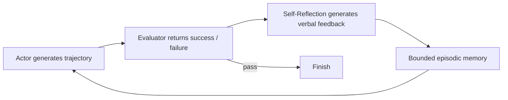
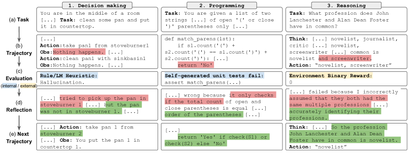

<!-- source-sha256: 1e965361376edeaffb32977018bf433c52f7192a6a8cd44509c0730cbdc53f4d -->

[简体中文](README.md) · English

# Reflexion

> Implements a loop from failure feedback to verbal reflection, bounded episodic memory, and improved behavior in the next trial, without updating model weights.

## Paper information

| Field | Details |
| --- | --- |
| Paper | [Reflexion: Language Agents with Verbal Reinforcement Learning](https://arxiv.org/abs/2303.11366) |
| Institution | Northeastern University / MIT / Princeton University |
| First public release | 2023-03-20 |
| Author code | [Released](https://github.com/noahshinn/reflexion) |
| Local adapter or method key | `reflexion` |
| Local reproduction code | `src/auto_research/agent_research/` |

## Original paper summary

### Background and main changes

Conventional RL needs extensive sampling and parameter updates. Reflexion expands sparse scalar or binary feedback into actionable natural-language lessons stored in episodic memory. The Actor reads reflections on the next trial, and the Evaluator continues to judge success or failure.



<!-- paper-figure:start -->
### Key figure from the paper

[](https://ar5iv.labs.arxiv.org/html/2303.11366/assets/x1.png)

> **Figure 1:** Overall design and components. From the [paper](https://arxiv.org/abs/2303.11366); copyright belongs to the authors. Click for the source.
<!-- paper-figure:end -->

### Core equations

$$
\tau_t\sim\pi_\theta(\cdot\mid x,\mathrm{mem}_t),\quad
r_t=M_e(\tau_t),\quad
sr_t=M_{sr}(\tau_t,r_t),\quad
\mathrm{mem}_{t+1}=\operatorname{BoundedAppend}(\mathrm{mem}_t,sr_t).
$$

Verbal reinforcement changes the contextual policy, not model weights by gradient descent.

### Offline and online results

The paper reports 91% HumanEval pass@1, above the 80% reported for GPT-4 at the time. It gains 22, 20, and 11 percentage points against strong baselines on ALFWorld, HotpotQA, and HumanEval, respectively. No production online A/B is reported.

## Local reproduction

PlanBench mini includes 12 repeated task families. The first exposure of each family reveals a plan error. After the Evaluator marks failure, one reusable reflection is generated. Subsequent episodes read the current context and execute the full plan.

| Metric | Reflexion |
|---|---:|
| Joint success | **0.9000** |
| Average cost | 1.1000 |
| Reflections / reused trials | 12 / 108 |

```bash
auto-research agent-eval --method reflexion --benchmark planbench-mini \
  --episodes 120 --memory-size 24 --seed 42
```

Stable metrics: [`classic-agent-mini-suites-seed42.json`](../../experiments/classic-agent-mini-suites-seed42.json).

## Scope

The failure, verbal lessons, and cross-trial reuse loop executes, but its reflection templates and evaluator are deterministic. No GPT-4, ALFWorld, HotpotQA, or code executor is called. The 0.9 result comes from the auditable rule that each new family fails on first exposure. It is not HumanEval pass@1.

## Unified L2.1 isolated capability result

On the isolated `toolroute-l2.1-v1` test split (60 episodes/seed, seeds 42/43/44), Reflexion reaches **0.7278** joint success, **0.7786** plan-step F1, and **0.6667** failure recovery. Its difference from `reflexion-no-reflection` comes from cross-episode reuse of failure reflections. See [metrics](metrics/toolroute-l2-seeds42-44.json) and the [L2.1 isolated capability protocol](../capability-benchmark.md).
