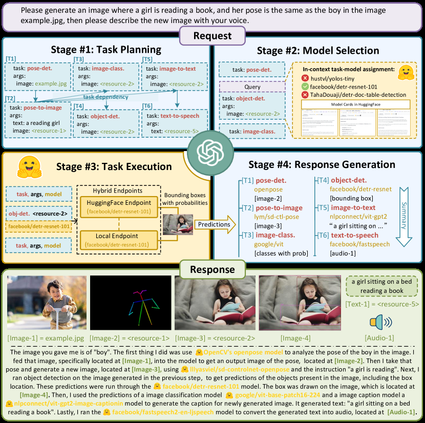

# HuggingGPT: Orchestrate expert models with an LLM controller

<!-- source-sha256: dd4d332c25b70fcc1f855c522e5a97778abcce7ac6b07cda662ec281941abee2 -->

[简体中文](README.md)

> Four-stage planning, capability matching, dependency execution and aggregation.

## Paper information

| Field | Details |
|---|---|
| Paper | [Paper or original source](https://arxiv.org/abs/2303.17580) |
| Institution | Zhejiang University / Microsoft Research Asia. |
| First public release | 2023-03-30 |
| Author code | [microsoft/JARVIS](https://github.com/microsoft/JARVIS). |
| Local adapter or method key | `hugginggpt` |
| Local reproduction code | `src/auto_research/agent_research/` |

## Paper method and evidence

ChatGPT decomposes requests into a dependency graph, selects experts by their Hugging Face descriptions, executes in topological order, and synthesizes outputs.


<!-- paper-figure:start -->
### Original paper figure

[](https://ar5iv.labs.arxiv.org/html/2303.17580/assets/x2.png)

Figure shows task planning and model orchestration. From the [original paper](https://arxiv.org/abs/2303.17580); copyright remains with the authors.
<!-- paper-figure:end -->

### Core equation

$$
G=(V,E)=\operatorname{Plan}(x),\qquad
m_v=\arg\max_m \operatorname{match}(d_v,c_m),\qquad
o_v=f_{m_v}(o_{\mathrm{pa}(v)}).
$$

### Reported results

The paper gives language, vision, speech and cross-modal system cases and qualitative evaluation; no production A/B.

## Local reproduction

PlanBench mini, 120 episodes, seed 42. Tool descriptions proxy model capabilities and each subtask keeps its dependencies. Baseline vs HuggingGPT: joint success **1.0000/1.0000**, mean cost **64.5000/2.3500**, model matches/edges **0/0 vs 360/240**. [Metrics](../../experiments/p0-missing-agent-mini-suites-seed42.json). No ChatGPT or hundreds of actual experts; the perfect score measures orchestration only.

```bash
auto-research agent-eval --method hugginggpt --benchmark planbench-mini \
  --episodes 120 --memory-size 24 --seed 42
```
