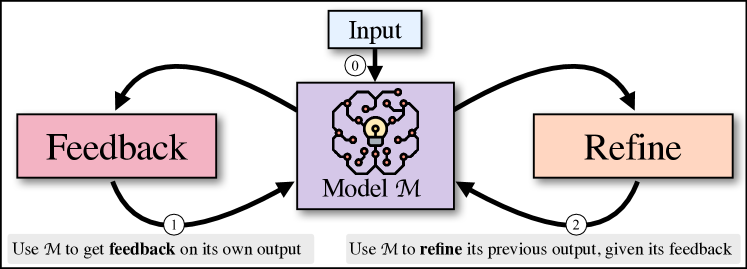

# Self-Refine: Iteratively improve answers with the model's own feedback

<!-- source-sha256: 5a1a0616bc08bfafc4cf3392fab8cdd8c8921c7917f536786d14f0d2a9f61eb3 -->

[简体中文](README.md)

> Explicit draft, critique, revision and stopping, not a full LLM benchmark.

## Paper information

| Field | Details |
|---|---|
| Paper | [Paper or original source](https://arxiv.org/abs/2303.17651) |
| Institution | Carnegie Mellon University / Allen Institute for AI / University of Washington / NVIDIA / UC San Diego / Google Research. |
| First public release | 2023-03-30 |
| Author code | [madaan/self-refine](https://github.com/madaan/self-refine). |
| Local adapter or method key | `self-refine` |
| Local reproduction code | `src/auto_research/agent_research/` |

## Paper method and evidence

One LLM writes a draft, produces actionable task-specific feedback, and revises until feedback says the constraints are met. No weight updates, extra training data, human feedback or external reward model.


<!-- paper-figure:start -->
### Original paper figure

[](https://ar5iv.labs.arxiv.org/html/2303.17651/assets/x1.png)

Figure shows generate–feedback–refine. From the [original paper](https://arxiv.org/abs/2303.17651); copyright remains with the authors.
<!-- paper-figure:end -->

### Core equation

$$
y_0=M_{\mathrm{gen}}(x),\qquad
f_t=M_{\mathrm{feedback}}(x,y_t),\qquad
y_{t+1}=M_{\mathrm{refine}}(x,y_t,f_t).
$$

### Reported results

The paper reports up to about 40 percentage points over one-shot generation across seven tasks, including human preference evaluation. No production A/B.

## Local reproduction

PlanBench mini, 120 episodes: joint success **1.0000**, mean cost **2.0000**, 120 feedback and 120 revision calls, 240 reasoning steps.

```bash
auto-research agent-eval --method self-refine \
  --benchmark planbench-mini --episodes 120 --seed 42
```

[Stable metrics](../../experiments/classic-agent-mini-suites-seed42.json). A deterministic critic verifies transitions; no general-purpose LLM or seven-task reproduction.
