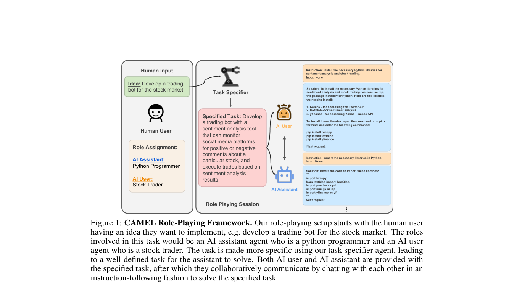

# CAMEL

<!-- source-sha256: 32b22e545300b80e737d6d9117ac65d462d39066549b31e6ccf37677925a7455 -->

[简体中文](README.md)

> Core mechanism, not full benchmark reproduction.

## Paper information

| Field | Value |
| --- | --- |
| Paper | [CAMEL (arXiv 2303.17760)](https://arxiv.org/abs/2303.17760) |
| Affiliations | King Abdullah University of Science and Technology |
| First public release | 2023-03-31 (arXiv v1) |
| Authors' code | [Author code](https://github.com/camel-ai/camel). |
| Adapter / method | `camel` |
| Local code | [`src/auto_research/agent_research/`](https://github.com/daiwk/auto-research/tree/main/src/auto_research/agent_research/) |

## Original paper

### Background and contribution

Inception prompts define user and assistant roles, goals, and constraints. Alternating messages solve tasks and produce multi-agent trajectories for study.


<!-- paper-figure:start -->
### Key figure from the paper

[](https://arxiv.org/pdf/2303.17760#page=4)

Original Figure 1: CAMEL. From the [paper](https://arxiv.org/abs/2303.17760); copyright belongs to the authors. Not a local result.
<!-- paper-figure:end -->

### Core mechanism

$$
m_t^A\sim\pi_A(\cdot|r_A,g,h_t),\quad m_t^B\sim\pi_B(\cdot|r_B,g,h_t,m_t^A).
$$

### Paper results

NeurIPS 2023 studies instruction-following cooperation. No production A/B.

## Local reproduction

planbench-mini, 120 episodes, seed 42: joint success **1.0000**, average cost **1.3500**. See [metrics](../../experiments/global-p1-20260808-seed42.json).

```bash
auto-research agent-study --method camel --benchmark planbench-mini --episodes 120 --seed 42
auto-research evolve --model agent --dataset planbench-mini --direction "Combine camel with installed paper operators" --generations 2 --population 4
```

## Reproduction limits

Deterministic mini-suite, not a large-model, multi-GPU, private-environment, or full benchmark reproduction.
