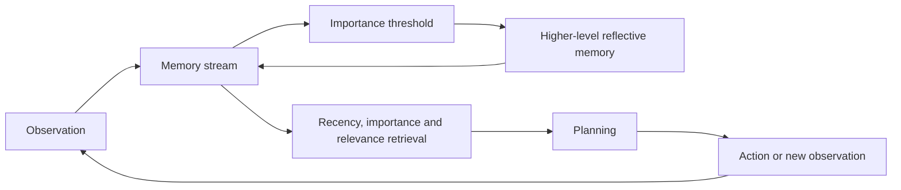
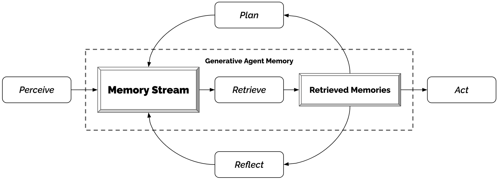

<!-- source-sha256: 560c3f265ecb081dc4a0a7a09237e97d44f5febb3929f83a3a699fb1128cf614 -->

[简体中文](README.md) · English

# Generative Agents: Memory, reflection and planning

> Implements relevance/recency/importance retrieval from a memory stream, reflection triggered by cumulative importance, and planning from retrieved memories.

## Paper information

| Field | Details |
| --- | --- |
| Paper | [Generative Agents: Interactive Simulacra of Human Behavior](https://arxiv.org/abs/2304.03442) |
| Institution | Stanford University / Google Research |
| First public release | 2023-04-07 |
| Author code | [Public author code](https://github.com/joonspk-research/generative_agents). |
| Local adapter or method key | `generative-agents` |
| Local reproduction code | `src/auto_research/agent_research/` |

## Original paper summary

### Background and main changes

Putting all history in an LLM context does not sustain coherent long-term behavior. Store observations in a memory stream and retrieve by recency, importance and relevance. Once cumulative importance crosses a threshold, generate higher-level reflections, then use memory and current state for schedules and action plans.



<!-- paper-figure:start -->
### Key figure from the paper

[](https://ar5iv.labs.arxiv.org/html/2304.03442/assets/figures/figure_architecture2.png)

> **Figure 5:** Core architecture, modules and connections. From the [paper](https://arxiv.org/abs/2304.03442); copyright belongs to the authors. Click for the source.
<!-- paper-figure:end -->

### Core equations

$$
s(m,q)=\alpha\,\mathrm{recency}(m)
+\beta\,\mathrm{importance}(m)
+\gamma\,\mathrm{relevance}(m,q).
$$

### Offline and online results

The 25-agent Smallville experiment demonstrates invitation diffusion, relationship formation and coordination. Human evaluation and ablations find that observation, planning and reflection all affect believability. No production A/B.

## Local reproduction

EvoMem-mini, 120 episodes, seed 42, memory size 24. Retrieve top 3 by the three-part score and synthesize reflections from cumulative importance.

| Metric | Long-context baseline | Generative Agents |
|---|---:|---:|
| Joint success | 1.0000 | 1.0000 |
| Average cost | 64.5000 | **1.7900** |
| Retrieved memories / reflections | 0 / 0 | 354 / 30 |

```bash
auto-research agent-eval --method generative-agents --benchmark evomem-mini \
  --episodes 120 --memory-size 24 --seed 42
```

Stable metrics: [`p0-missing-agent-mini-suites-seed42.json`](../../experiments/p0-missing-agent-mini-suites-seed42.json).

## Scope

Reproduces memory scoring, reflection triggers and planning dependencies. No 25 LLM personas, Smallville map or human believability evaluation were run. Compare only execution success, proxy context cost and internal state.
