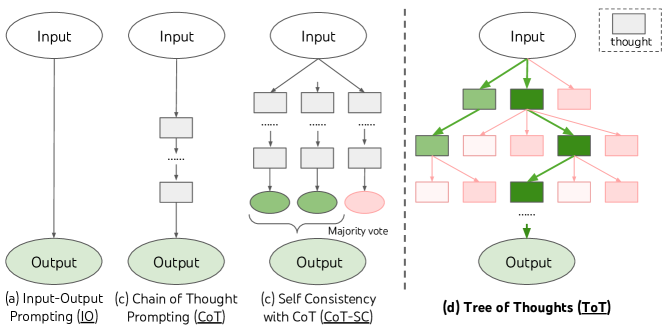

# Tree of Thoughts

<!-- source-sha256: 15d2dd3bb74da5efa3e7835189a36222a151d4c6c48d1ad25d93d5c8c8d67a0f -->

[简体中文](README.md)

> Thought branching, BFS beam selection, value evaluation and backtracking; not single-chain CoT.

## Paper information

| Field | Details |
|---|---|
| Paper | [Tree of Thoughts: Deliberate Problem Solving with Large Language Models](https://arxiv.org/abs/2305.10601) |
| Institution | Princeton University / Google DeepMind. |
| First public release | 2023-05-17 |
| Author code | [princeton-nlp/tree-of-thought-llm](https://github.com/princeton-nlp/tree-of-thought-llm). |
| Local adapter or method key | `tree-of-thoughts` |
| Local reproduction code | `src/auto_research/agent_research/` |

## Paper method and evidence

Treat intermediate thoughts as independently evaluable units. Expand multiple candidates, score the frontier with an LM value function, and search BFS or DFS with lookahead and backtracking instead of committing to one chain.


<!-- paper-figure:start -->
### Original paper figure

[](https://ar5iv.labs.arxiv.org/html/2305.10601/assets/x1.png)

The original figure contrasts thought-search strategies. From the [original paper](https://arxiv.org/abs/2305.10601); copyright remains with the authors.
<!-- paper-figure:end -->

### Core equation

$$
S_{t+1}=\operatorname{TopK}_{s'\in\operatorname{Expand}(S_t)}
V_\theta(s'),\qquad
y^*=\arg\max_{y\in\mathcal T}V_\theta(y).
$$

### Reported results

With GPT-4 on Game of 24, CoT succeeds 4% and ToT 74%. The paper also tests creative writing and mini crosswords; no production A/B.

## Local reproduction

```bash
auto-research agent-eval --method tree-of-thoughts \
  --benchmark planbench-mini --episodes 120 --seed 42
```

PlanBench mini expands correct and distracting action thoughts layerwise using deterministic workflow coherence and beam width 2. Joint success **1.0000**, mean cost **2.5000**, expanded nodes/backtracks **1200 / 480**. [Stable metrics](../../experiments/classic-agent-mini-suites-seed42.json). No GPT-4 self-evaluation or Game of 24; the perfect score verifies search mechanics only.
