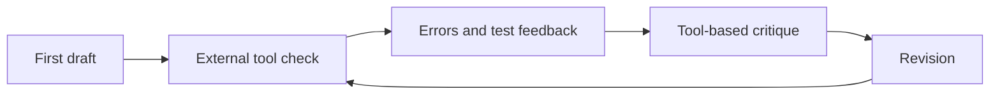
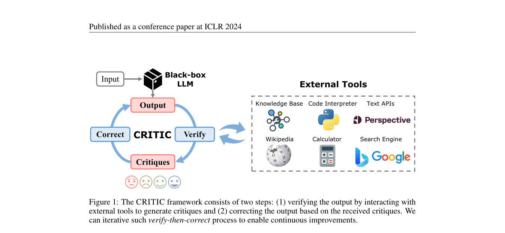

# CRITIC

<!-- source-sha256: 1315b411313b3dc0c0fcd7c117961e86175716d435d67bba8c08a18e98eb2324 -->

[简体中文](README.md)

> Use tool feedback to verify and revise a first draft.

## Paper information

| Field | Value |
| --- | --- |
| Paper | [CRITIC: Large Language Models Can Self-Correct with Tool-Interactive Critiquing](https://arxiv.org/abs/2305.11738) |
| Affiliations | Microsoft / Tsinghua University |
| First public release | 2023-05-19 |
| Authors' code | [Author code](https://github.com/microsoft/ProphetNet/tree/master/CRITIC). |
| Adapter / method | `critic` |
| Local code | `src/auto_research/agent_research/` |

## Original paper

### Background and contribution

Pure reflection can repeat a model's original mistake. CRITIC adds observable evidence from external tools, such as search and code execution, to each critique-and-revision iteration.



<!-- paper-figure:start -->
### Key figure from the paper

[](https://arxiv.org/pdf/2305.11738#page=2)

Original Figure 1: CRITIC. From the [paper](https://arxiv.org/abs/2305.11738); copyright belongs to the authors. Not a local result.
<!-- paper-figure:end -->

### Core mechanism

$$
y^{(t+1)}=\operatorname{Revise}\!\left(
x,y^{(t)},\operatorname{Tool}(y^{(t)})\right).
$$

### Paper results

The paper reports consistent gains in open QA, math program synthesis, and toxicity reduction. No production A/B.

## Local reproduction

Write a defective patch, run actual unittest, then revise and retest from the traceback. Record edit, command, status, and output. See [stable metrics](../../experiments/agent-code-sandbox-seed42.json).

```bash
auto-research agent-eval --method critic --benchmark swebench-local \
  --episodes 12 --seed 42
```

## Reproduction limits

The environment actually executes feedback and edits, but is a controlled code test. No search engine, toxicity classifier, or general LLM critic.
