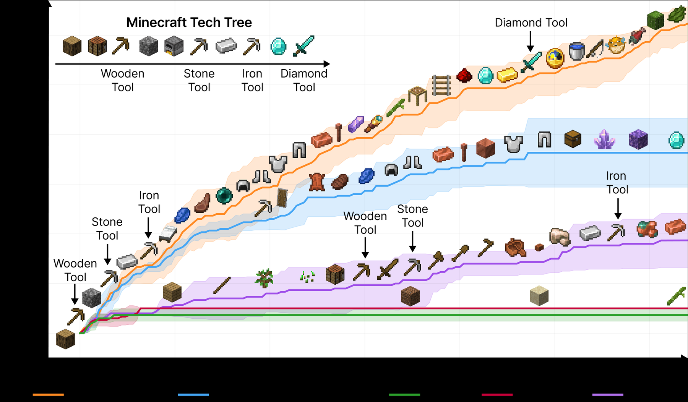

<!-- source-sha256: 97016f56264d541ae2ed051159259b91c5d6b798ee6d7c23967472be408edf75 -->

[简体中文](README.md) · English

# Voyager

> Implements an automatic curriculum, execution feedback/self-verification, and a reusable executable skill library that grows over time. It does not reproduce the Minecraft world locally.

## Paper information

| Field | Details |
| --- | --- |
| Paper | [Voyager: An Open-Ended Embodied Agent with Large Language Models](https://arxiv.org/abs/2305.16291) |
| Institution | NVIDIA / Caltech / UT Austin / Stanford / ASU |
| First public release | 2023-05-25 |
| Author code | [Released code](https://github.com/MineDojo/Voyager). |
| Local adapter or method key | `voyager` |
| Local reproduction code | `src/auto_research/agent_research/` |

## Original paper summary

### Background and main changes

Open-world agents need to keep choosing novel tasks, retain successful skills, and repair programs from environment errors. Voyager uses GPT-4 to generate curricula and code as its action space. Successful programs are indexed by description in a skill library, then retrieved and composed for new tasks.


<!-- paper-figure:start -->
### Key figure from the paper

[](https://ar5iv.labs.arxiv.org/html/2305.16291/assets/figures/main_experiment_fig.png)

> **Figure 1:** Overall design and components. From the [paper](https://arxiv.org/abs/2305.16291); copyright belongs to the authors. Click for the source.
<!-- paper-figure:end -->

### Core equations

$$
g_t=\operatorname{Curriculum}(s_t,\mathcal S_t),\quad
z_t=\operatorname{Generate}(g_t,s_t,\operatorname{Retrieve}(\mathcal S_t,g_t)),
\quad
\mathcal S_{t+1}=\mathcal S_t\cup\{z_t\}\ \text{if Verify}(z_t)=1.
$$

### Offline and online results

In Minecraft, the paper reports 3.3× as many unique items, 2.3× exploration distance and up to 15.3× faster tech-tree milestones. The library transfers to unseen tasks in new worlds. No production A/B test.

## Local reproduction

Run a fixed 120 PlanBench-mini episodes. New task families trigger generation, execution and self-verification, with success saved to the skill library. Later tasks with the same procedure retrieve it directly.

| Metric | Voyager |
|---|---:|
| Joint success | **1.0000** |
| Average cost | 1.1200 |
| Skills created / reused | 12 / 108 |
| Verification retries | 12 |

```bash
auto-research agent-eval --method voyager --benchmark planbench-mini \
  --episodes 120 --memory-size 24 --seed 42
```

Stable metrics: [`classic-agent-mini-suites-seed42.json`](../../experiments/classic-agent-mini-suites-seed42.json).

## Scope

Retains curriculum, skills, verification and cross-episode reuse. Local skills are structured tool plans, not Mineflayer JavaScript. Minecraft, GPT-4 and embedding retrieval were not run.
