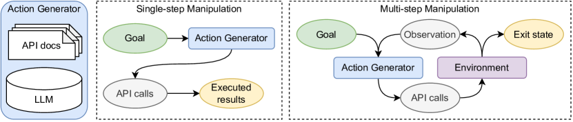

# ToolBench / ToolLLM

<!-- source-sha256: fd653767ec3fa982a58d46113cc484e01ca09bd226f37c053732507df14ccd13 -->

[简体中文](README.md)

> **Fidelity: core mechanism.** The deterministic mini-suite does not stand in for the paper's full benchmark.

## Paper information

| Field | Details |
|---|---|
| Paper | [ToolBench / ToolLLM (arXiv 2305.16504)](https://arxiv.org/abs/2305.16504) |
| Organization | Tsinghua University |
| First public release | 2023-05-25 (arXiv v1) |
| Authors' code | No official code repository from the authors was found. |
| Adapter / method | `toolbench` |
| Local reproduction code | [`src/auto_research/agent_research/`](https://github.com/daiwk/auto-research/tree/main/src/auto_research/agent_research/) |

## Original paper

### Motivation and method

After analyzing tool failures in open-source LLMs, the method combines programmatic usage examples, a system prompt, retrieval of in-context demonstrations, and output-format constraints.


<!-- paper-figure:start -->
### Key figure from the paper

[](https://ar5iv.labs.arxiv.org/html/2305.16504/assets/x1.png)

> **Figure 1:** Overview of the paper's method and key components. From the [original paper](https://arxiv.org/abs/2305.16504); copyright remains with the authors.
<!-- paper-figure:end -->

### Core equations

$$
a^*=\arg\max_a p_\theta(a|x,D_{tool},p_{sys}),\quad R=\mathbf1[\operatorname{execute}(a)=y].
$$

### Paper results

Up to 90% tool success, with performance competitive with GPT-4 on four of eight ToolBench tasks. No production online A/B is reported; there are no inferred online numbers.

## Local reproduction

On planbench-mini with 120 episodes and seed 42, joint success is **1.0000** and average cost **0.8400**.

```bash
auto-research agent-study --method toolbench --benchmark planbench-mini --episodes 120 --seed 42
auto-research evolve --model agent --dataset planbench-mini --direction "组合 toolbench 与已安装论文算子" --generations 2 --population 4
```

See the [fixed metrics](../../experiments/global-p1-20260808-seed42.json).

## Reproduction boundaries

The local run checks the paper-specific objective, state update, or evaluation protocol. It does not reproduce the large model, multi-GPU training, private environments, or full public benchmark.
