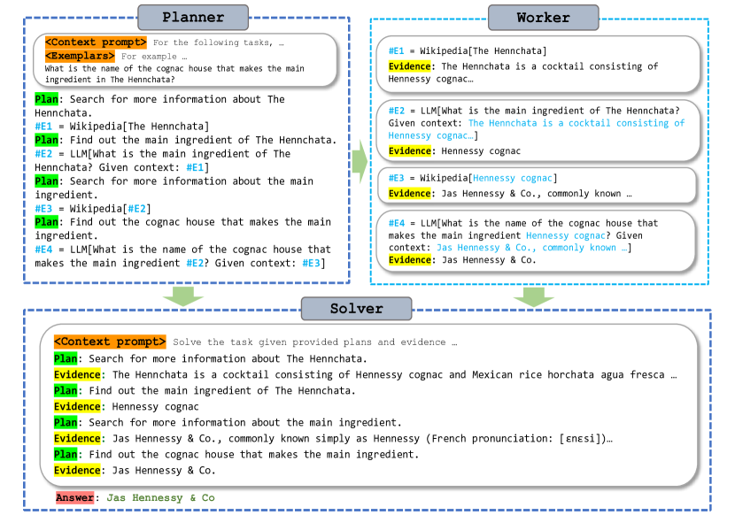

# ReWOO: Decouple planning from tool observations

<!-- source-sha256: ad0b4fa6b85e9984567a3f0041aa3cc13a9d769706c4c5b5562b7e33d70784ff -->

[简体中文](README.md)

> Explicit Planner/Worker/Solver dependencies and evidence aggregation.

## Paper information

| Field | Details |
|---|---|
| Paper | [Paper or original source](https://arxiv.org/abs/2305.18323) |
| Institution | Microsoft Research / North Carolina State University / Texas A&M University. |
| First public release | 2023-05-29 |
| Author code | [billxbf/ReWOO](https://github.com/billxbf/ReWOO). |
| Local adapter or method key | `rewoo` |
| Local reproduction code | `src/auto_research/agent_research/` |

## Paper method and evidence

Instead of reprompting a ReAct planner after every tool response, write a full plan with variable references. A Worker populates tool evidence and a Solver integrates it once at the end.


<!-- paper-figure:start -->
### Original paper figure

[](https://ar5iv.labs.arxiv.org/html/2305.18323/assets/x1.png)

Figure shows the plan, worker and solver separation. From the [original paper](https://arxiv.org/abs/2305.18323); copyright remains with the authors.
<!-- paper-figure:end -->

### Core equation

$$
P=\{(E_i,T_i,a_i(E_{<i}))\}_{i=1}^{n},\qquad
e_i=T_i(a_i(e_{<i})),\qquad y=S(x,P,e_{1:n}).
$$

### Reported results

Paper reports about 5× token efficiency, about +4 points on HotpotQA, and planner offload from 175B to 7B. No production A/B.

## Local reproduction

PlanBench mini, 120 episodes: joint success **1.0000**, mean cost **3.5000**, 120 full plans and 360 tool/worker actions. [Metrics](../../experiments/classic-agent-mini-suites-seed42.json). No real search API, multi-size LLM, or HotpotQA generation.

```bash
auto-research agent-eval --method rewoo \
  --benchmark planbench-mini --episodes 120 --seed 42
```
