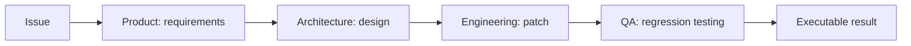
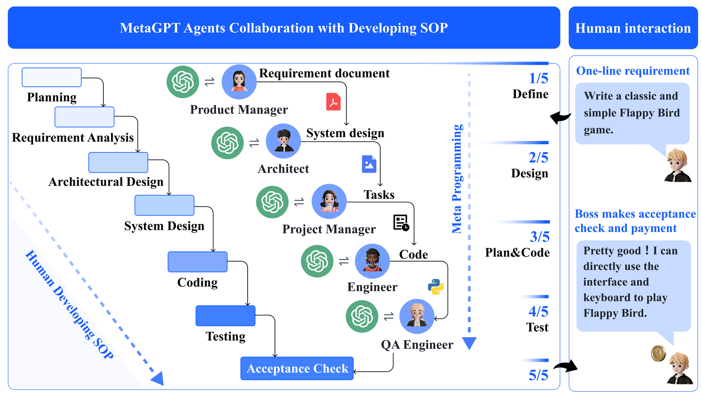

# MetaGPT

<!-- source-sha256: 85df7cdd8d7ae4151ebb5fc8978fd4997311c99353151903f093be3c53cc1ccb -->

[简体中文](README.md)

> Uses a standard operating procedure (SOP) to hand software requirements from product to architecture, engineering, and testing roles.

## Paper information

| Field | Details |
|---|---|
| Paper | [MetaGPT: Meta Programming for A Multi-Agent Collaborative Framework](https://arxiv.org/abs/2308.00352) |
| Organization | DeepWisdom / Xiamen University / KAUST and others |
| First public release | 2023-08-01 |
| Authors' code | [Public implementation](https://github.com/FoundationAgents/MetaGPT) |
| Adapter / method | `metagpt` |
| Local reproduction code | `src/auto_research/agent_research/` |

## Original paper

### Motivation and method

Chaining chat agents can cascade hallucinations. MetaGPT encodes human software-team SOPs as role-based message flows. Each role produces structured intermediates for downstream roles to consume and verify.



<!-- paper-figure:start -->
### Key figure from the paper

[](https://ar5iv.labs.arxiv.org/html/2308.00352/assets/imgs/1-metagpt_overall_update.png)

> **Figure 1:** Overview of the paper's method and key components. From the [original paper](https://arxiv.org/abs/2308.00352); copyright remains with the authors.
<!-- paper-figure:end -->

### Core equations

The defining mechanism is the workflow, not one loss. Locally it is an ordered state transition:

$$
s_{t+1}=f_{r_t}(s_t,a_t),\qquad
r_t\in\{\mathrm{PM,Architect,Engineer,QA}\}.
$$

### Paper results

On collaborative software-engineering tasks such as HumanEval and MBPP, the paper reports more coherent and executable results than chat-based multi-agent systems. No production online A/B test is reported.

## Local reproduction

Each episode creates a real temporary Python repository. Four roles write structured artifacts; engineering edits files and QA runs a fixed `python -m unittest -q` regression command.

```bash
auto-research agent-eval --method metagpt --benchmark swebench-local \
  --episodes 12 --seed 42
```

See the [stable metrics](../../experiments/agent-code-sandbox-seed42.json).

## Reproduction boundaries

The local implementation retains SOPs, role deliverables, real edits, and testing. It does not reproduce full MetaGPT LLM dialogue or official SWE-bench Lite. Fixtures check only the executable path and auditable trace.
