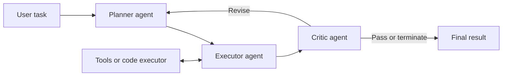
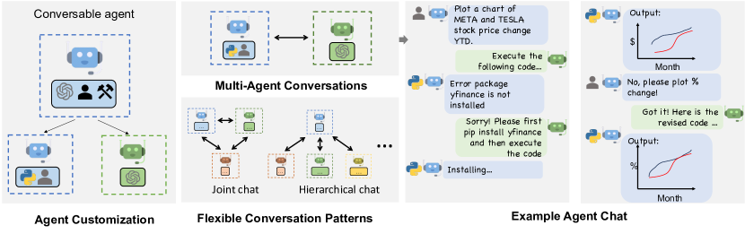

# AutoGen: programmable multi-agent conversations

<!-- source-sha256: e69c687bca917b0de609888dbb938a589eca73776f0544bd4b09d1d2627d0ab9 -->

[简体中文](README.md)

> Represents agents as configurable conversational roles. Message routing and stopping conditions coordinate planners, executors, critics, humans, or tools.

## Paper information

| Field | Details |
|---|---|
| Paper | [AutoGen: Enabling Next-Gen LLM Applications via Multi-Agent Conversation](https://arxiv.org/abs/2308.08155) |
| Organization | Microsoft Research |
| First public release | 2023-08-16 |
| Authors' code | [microsoft/autogen](https://github.com/microsoft/autogen) is public. |
| Adapter / method | `autogen` |
| Local reproduction code | `src/auto_research/agent_research/` |

## Original paper

### Motivation and method

Complex applications need models, tools, and humans to collaborate; hand-written control flow is hard to reuse. ConversableAgent and conversation programming let roles declare capabilities, reply policies, and termination conditions, then combine them through group chats or nested conversations.



<!-- paper-figure:start -->
### Key figure from the paper

[](https://ar5iv.labs.arxiv.org/html/2308.08155/assets/x1.png)

> **Figure 1:** Core architecture, modules, and connections. From the [original paper](https://arxiv.org/abs/2308.08155); copyright remains with the authors.
<!-- paper-figure:end -->

### Core equations

AutoGen is an orchestration abstraction rather than a new loss. It can be written as a message-driven state machine:

$$
m_{t+1}=A_{r_t}(H_t,\mathcal T_{r_t}),\qquad
H_{t+1}=H_t\cup\{(r_t,m_{t+1})\},\qquad
\text{stop}(H_{t+1})\in\{0,1\}.
$$

### Paper results

Mathematics, code generation, QA, and decision-making applications illustrate capability and development-efficiency gains over one agent. These are application evaluations and case studies, not a production online A/B test.

## Local reproduction

On 120 fixed PlanBench mini episodes, joint success is 1.0000 and average cost 3.0000. Logs contain 120 plans, 360 cross-role messages, and 120 critic rounds.

```bash
auto-research agent-eval --method autogen \
  --benchmark planbench-mini --episodes 120 --seed 42
```

See the [stable metrics](../../experiments/classic-agent-mini-suites-seed42.json).

## Reproduction boundaries

The planner/executor/critic message protocol, handoff, and explicit termination are implemented. The full AutoGen runtime, container code execution, and real LLM group conversations are not. A 1.0 score checks deterministic control flow, not the paper's application performance.
