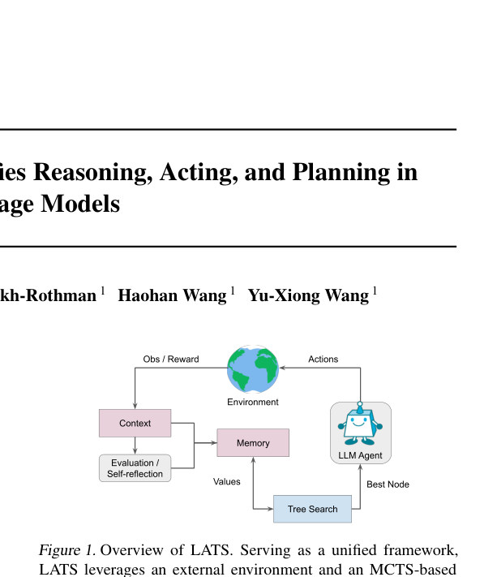

# LATS: Language Agent Tree Search

<!-- source-sha256: 8ae228f18aa0e2c89a457475688d251bb0c2899ee86fcd2b3e0a4e4d44411c4c -->

[简体中文](README.md)

> UCT-style search with complete rollouts, environment reward and reflection.

## Paper information

| Field | Details |
|---|---|
| Paper | [Paper or original source](https://arxiv.org/abs/2310.04406) |
| Institution | University of Illinois Urbana-Champaign. |
| First public release | 2023-10-06 |
| Author code | [lapisrocks/LanguageAgentTreeSearch](https://github.com/lapisrocks/LanguageAgentTreeSearch). |
| Local adapter or method key | `lats` |
| Local reproduction code | `src/auto_research/agent_research/` |

## Paper method and evidence

Use an LM as agent, value function and optimizer within MCTS. External execution supplies rewards; reflections on failed traces guide later exploration and backtracking.


<!-- paper-figure:start -->
### Original paper figure

[](https://arxiv.org/pdf/2310.04406#page=1)

Figure shows search and reflection. From the [original paper](https://arxiv.org/abs/2310.04406); copyright remains with the authors.
<!-- paper-figure:end -->

### Core equation

$$
\operatorname{UCT}(s,a)=Q(s,a)+c\sqrt{\frac{\log N(s)}{N(s,a)}},
\qquad
Q(s,a)\leftarrow Q(s,a)+\frac{r-Q(s,a)}{N(s,a)}.
$$

### Reported results

The latest paper reports GPT-4 HumanEval pass@1 92.7% and GPT-3.5 WebShop score 75.9. Also tests coding, interactive QA, navigation and math; no production A/B.

## Local reproduction

Four full plans per PlanBench episode; exact-plan rewards and reflections/backtracking on failures, then select by cumulative value. Joint success **1.0000**, mean cost **4.0000**, rollouts/reflections/backtracks **480/360/360**. [Metrics](../../experiments/classic-agent-mini-suites-seed42.json). Leaves are complete plans, not LM value calls. No HumanEval executor or WebShop; local search is much smaller.

```bash
auto-research agent-eval --method lats \
  --benchmark planbench-mini --episodes 120 --seed 42
```
