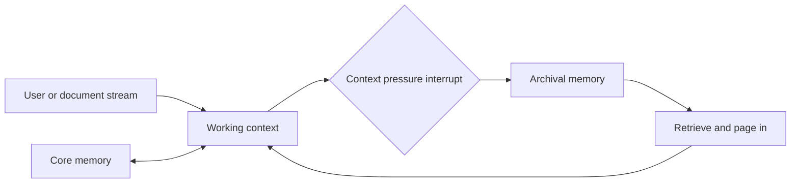
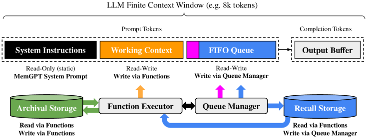

# MemGPT: virtual memory for limited contexts

<!-- source-sha256: 468b0f83c09cf59f74f1961de490d034f5f454baae55fa2a36fcb391aa4407f3 -->

[简体中文](README.md)

> Implements core, working, and archival state. Working-context pressure triggers an interrupt and page-out, with page-in on later tasks.

## Paper information

| Field | Details |
|---|---|
| Paper | [MemGPT: Towards LLMs as Operating Systems](https://arxiv.org/abs/2310.08560) |
| Organization | University of California, Berkeley |
| First public release | 2023-10-12 |
| Authors' code | [The authors' public code, now Letta](https://github.com/letta-ai/letta). |
| Adapter / method | `memgpt` |
| Local reproduction code | `src/auto_research/agent_research/` |

## Original paper

### Motivation and method

Limited context windows forget information in long documents and conversations. MemGPT borrows operating-system virtual memory: resident core information, active working context, and an external archive. Function calls move data, and interrupts or heartbeats control continued reasoning and interaction with the user.



<!-- paper-figure:start -->
### Key figure from the paper

[](https://ar5iv.labs.arxiv.org/html/2310.08560/assets/x3.png)

> **Figure 3:** Overview of the paper's method and key components. From the [original paper](https://arxiv.org/abs/2310.08560); copyright remains with the authors.
<!-- paper-figure:end -->

### Core equations

$$
\text{if }|W_t|>B:\quad
A_{t+1}=A_t\cup\operatorname{pageout}(W_t),\qquad
W_{t+1}\leftarrow\operatorname{pagein}(q,A_{t+1}).
$$

### Paper results

Document analysis beyond the base-model window and multi-session conversations compare fixed-context and retrieval baselines, showing persistent memory and dynamic reflection. No production online A/B is reported.

## Local reproduction

EvoMem mini, 120 episodes, seed 42, memory size 24. Working memory uses half the capacity; pressure triggers page-out and repeated tasks page in from archival memory.

| Metric | Long-context baseline | MemGPT |
|---|---:|---:|
| Joint success | 1.0000 | 1.0000 |
| Average cost | 64.5000 | **0.9200** |
| Archival writes / page-ins / interrupts | 0 / 0 / 0 | 108 / 96 / 108 |

```bash
auto-research agent-eval --method memgpt --benchmark evomem-mini \
  --episodes 120 --memory-size 24 --seed 42
```

See the [stable metrics](../../experiments/p0-missing-agent-mini-suites-seed42.json).

## Reproduction boundaries

Implements memory tiers, page-in/out, and interrupt counts. Archival retrieval uses deterministic keys, not embedding services or LLM function calling. Cost is the shared proxy cost, not tokens or online latency.
