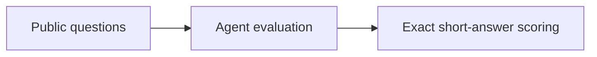
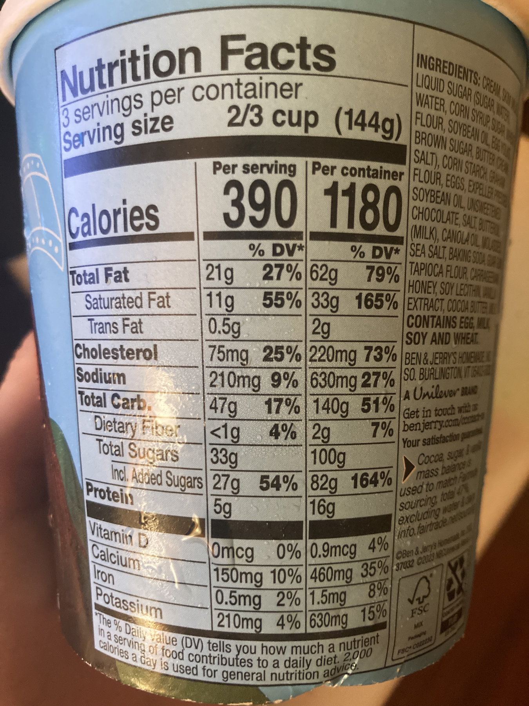

# GAIA

<!-- source-sha256: d8d18cafe45824ad6fa4841b6479dcba2a378c11b88c2ae895ce595192a50d1f -->

[简体中文](README.md)

> **Core benchmark mechanism**, not a full benchmark reproduction.

## Paper information

| Field | Value |
| --- | --- |
| Paper | [GAIA (arXiv 2311.12983)](https://arxiv.org/abs/2311.12983) |
| Affiliations | Meta AI |
| First public release | 2023-11-21 (arXiv v1) |
| Authors' code | Yes: [official benchmark](https://huggingface.co/gaia-benchmark). |
| Adapter / method | `gaia` |
| Local code | [`src/auto_research/agent_research/`](https://github.com/daiwk/auto-research/tree/main/src/auto_research/agent_research/) |

## Original paper

### Background and contribution

Evaluate reasoning, multimodality, browsing, and tool use on 466 real problems with exact short answers and three difficulty levels.



<!-- paper-figure:start -->
### Key figure from the paper

[](https://ar5iv.labs.arxiv.org/html/2311.12983/assets/figures/ice_cream.jpg)

Original Figure 1: GAIA. From the [paper](https://arxiv.org/abs/2311.12983); copyright belongs to the authors. Not a local result.
<!-- paper-figure:end -->

### Core mechanism

$$
\operatorname{score}=N^{-1}\sum_i\mathbf1[\operatorname{normalize}(\hat y_i)=\operatorname{normalize}(y_i)].
$$

### Paper results

Humans 92%, plugin-equipped GPT-4 15%; 300 answers reserved for leaderboard. No production A/B.

## Local reproduction

gaia-mini, 120 episodes, seed 42: joint success **1.0000**, average cost **1.4000**. See [metrics](../../experiments/global-p1-20260808-seed42.json).

```bash
auto-research agent-study --method gaia --benchmark gaia-mini --episodes 120 --seed 42
auto-research evolve --model agent --dataset gaia-mini --direction "Combine gaia with installed paper operators" --generations 2 --population 4
```

## Reproduction limits

Only the protocol is diagnosed on a deterministic mini-suite; no original full benchmark, large model, multi-GPU training, or private environment.
