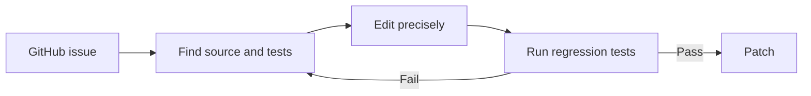
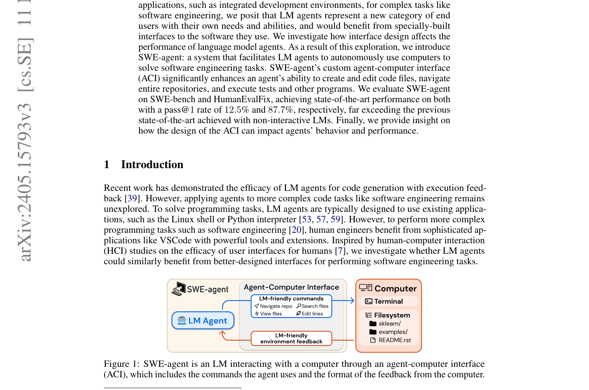

# SWE-agent

<!-- source-sha256: dba28d4fec2bf383c2fb6b3cff63a667c1dc81f7214f383d9718338c6f5d3be1 -->

[简体中文](README.md)

> An Agent–Computer Interface for browsing, editing, and testing code repositories with software-engineering agents.

## Paper information

| Field | Details |
|---|---|
| Paper | [SWE-agent: Agent-Computer Interfaces Enable Automated Software Engineering](https://arxiv.org/abs/2405.15793) |
| Organization | Princeton University |
| First public release | 2024-05-06 |
| Authors' code | [Public implementation](https://github.com/SWE-agent/SWE-agent) |
| Adapter / method | `swe-agent` |
| Local reproduction code | `src/auto_research/agent_research/` |

## Original paper

### Motivation and method

A general-purpose shell exposes an overly broad action space and verbose output to an LLM. SWE-agent's specialized ACI constrains repository search, file viewing, precise editing, and testing so the model can locate the cause of an issue and validate a patch.



<!-- paper-figure:start -->
### Key figure from the paper

[](https://arxiv.org/pdf/2405.15793#page=1)

> **Figure 1:** Overview of the paper's method and key components. From the [original paper](https://arxiv.org/abs/2405.15793); copyright remains with the authors.
<!-- paper-figure:end -->

### Core equations

$$
a_t\sim\pi(\cdot|o_{\le t},I),\qquad
o_{t+1}=\operatorname{ACI}(R_t,a_t).
$$

### Paper results

SWE-bench shows benefits from ACI when fixing real GitHub issues. It is an offline software-engineering benchmark, not a production online A/B test.

## Local reproduction

The local ACI exposes only file reads, writes to `solution.py`, and a fixed unittest command. Each starting repository must fail a real test; the agent locates the issue, edits, and validates by exit code.

```bash
auto-research agent-eval --method swe-agent --benchmark swebench-local \
  --episodes 12 --seed 42
```

See the [stable metrics](../../experiments/agent-code-sandbox-seed42.json).

## Reproduction boundaries

This is an executable SWE-style microbenchmark, not official SWE-bench Lite data or its Docker images. The `swebench-local` name preserves that distinction. Local success is not the paper's resolved rate.
