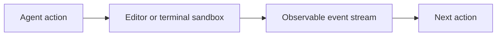
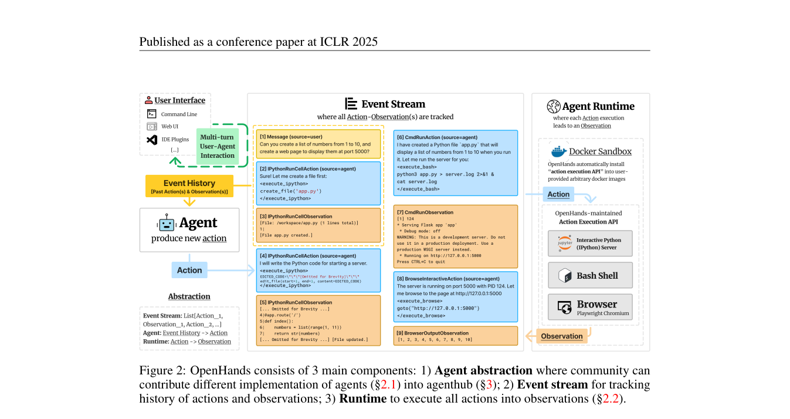

# OpenHands

<!-- source-sha256: 5bcd4f747ffbe70bea4a8dcd08932ac2b59524071b944205121a99a634cb5758 -->

[简体中文](README.md)

> Local editor/terminal events and real code execution in an isolated working directory; not the complete OpenHands platform.

## Paper information

| Field | Details |
|---|---|
| Paper | [OpenHands: An Open Platform for AI Software Developers as Generalist Agents](https://arxiv.org/abs/2407.16741) |
| Institution | All-Hands-AI / Carnegie Mellon University and collaborators. |
| First public release | 2024-07-23 |
| Author code | [All-Hands-AI/OpenHands](https://github.com/All-Hands-AI/OpenHands). |
| Local adapter or method key | `openhands` |
| Local reproduction code | `src/auto_research/agent_research/` |

## Paper method and evidence

OpenHands is an open software agent platform. It unifies terminal, editor and browser actions in an observable event stream and isolates execution in a sandbox for bug fixes, implementation and repository maintenance.



<!-- paper-figure:start -->
### Original paper figure

[](https://arxiv.org/pdf/2407.16741#page=3)

The original figure shows the agent's event-driven platform. From the [original paper](https://arxiv.org/abs/2407.16741); copyright remains with the authors.
<!-- paper-figure:end -->

### Core equation

$$
e_{t+1}=\operatorname{Sandbox}(a_t),\qquad
a_{t+1}=\pi(g,e_{\le t+1}).
$$

### Reported results

The paper evaluates the platform and multiple controllers on software-engineering benchmarks including SWE-bench. No production A/B.

## Local reproduction

Local editor and terminal actions write to the event stream. The terminal runs a fixed regression test in a separate temporary directory and reports actions, edit hashes, command output and success.

```bash
auto-research agent-eval --method openhands --benchmark swebench-local \
  --episodes 12 --seed 42
```

[Stable metrics](../../experiments/agent-code-sandbox-seed42.json). Browser actions currently retain interface semantics only. No live browser, full controller, or official SWE-bench container.
