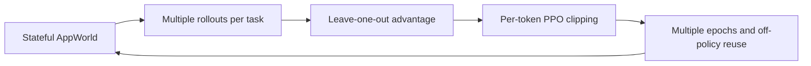
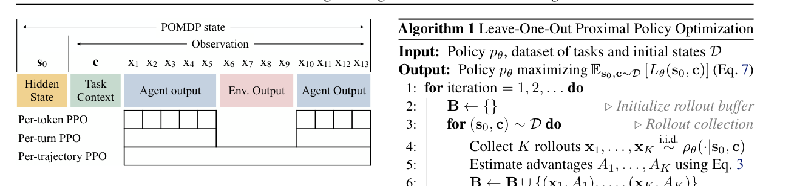

# LOOP: PPO without a value network for long-horizon interactive agents

<!-- source-sha256: fb686b27ba4596f2d8ec4a0c39a0700f75e3db48f4ecec24a9101e1649a259b9 -->

[简体中文](README.md)

> **Fidelity:** Checks multi-trajectory sampling, leave-one-out advantages, off-policy reuse, and per-token trust-region clipping. This is a deterministic mini-suite, not AppWorld 32B training.

## Paper information

| Field | Details |
|---|---|
| Paper | [Reinforcement Learning for Long-Horizon Interactive LLM Agents](https://arxiv.org/abs/2502.01600) |
| Organization | Apple |
| First public release | 2025-02-03 |
| Authors' code | [apple/ml-loop](https://github.com/apple/ml-loop) |
| Adapter / method | `loop` |
| Local reproduction code | [`src/auto_research/agent_research/`](https://github.com/daiwk/auto-research/tree/main/src/auto_research/agent_research) |

## Original paper

### Motivation and method

Long-horizon digital-agent rollouts are expensive, and standard PPO also maintains a value model. LOOP combines PPO's trust region with a leave-one-out baseline so it can update repeatedly on a batch without a critic. Token-level importance-ratio clipping limits drifting tokens without discarding whole long trajectories.



<!-- paper-figure:start -->
### Key figure from the paper

[](https://arxiv.org/abs/2502.01600)

> **Figure 2:** Compares per-token, per-turn, and per-trajectory PPO in an interactive POMDP. Copyright remains with the authors.
<!-- paper-figure:end -->

### Core equations

$$
A_k=R_k-\frac1{K-1}\sum_{i\ne k}R_i,\qquad
L=\frac1{|x|}\sum_t\min(\rho_tA_k,\operatorname{clip}(\rho_t)A_k).
$$

### Paper results

On AppWorld, the paper's 32B model beats the larger OpenAI o1 by `9` percentage points (`15%` relative). It also hallucinates less, consults API documentation more, and recovers from failures more often. No production online A/B is reported.

## Local reproduction

```bash
auto-research agent-eval --method loop \
  --benchmark planbench-mini --episodes 120 --seed 42
```

| Metric | Local result |
|---|---:|
| Joint success | 1.0000 |
| Average cost | 2.2000 |
| Off-policy reuse | 476 |
| Leave-one-out updates / per-token clips | 480 / 120 |

See the [stable metrics](../../experiments/omitted-agentic-rl-opd-seed42.json).

## Reproduction boundaries

Actual trajectory selection and statistical updates run locally, but not AppWorld, a 32B LLM, or gradient checkpoint training. A perfect mini-suite score checks trajectory control logic, not performance on the paper's tasks.
