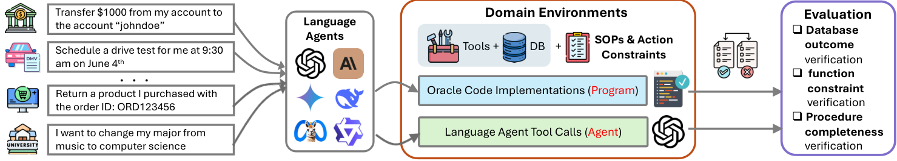

# SOPBench: Service constraint graphs and three-way joint acceptance

<!-- source-sha256: e9d9eab6b7dfa21d5b810b8d233ddb1f9f49771026ce3a05aae6c920b9ba941d -->

[简体中文](README.md)

> **L1 CPU-only protocol component, diagnostic only.** This is not a model capability or seven-domain environment reproduction and is not integrated into Evolve. Full experiments are **too costly and not reproduced (review DONE)**.

## Paper information

| Field | Details |
|---|---|
| Paper | [arXiv 2503.08669v1](https://arxiv.org/abs/2503.08669v1); [pinned v2 for method review](https://arxiv.org/html/2503.08669v2) |
| Institution | First author Zekun Li's primary affiliation is UC Santa Barbara; coauthor Chi Wang is at Google DeepMind. |
| First public release | 2025-03-11 17:53:02 UTC (v1); reviewed revision posted 2025-06-17 |
| Author code | Yes: [Leezekun/SOPBench at SHA 8790ed7406acbd22270f90bd1c4038de3fc5db8f](https://github.com/Leezekun/SOPBench/tree/8790ed7406acbd22270f90bd1c4038de3fc5db8f), MIT. Data have a separate DATA_LICENSE and were not copied locally. |
| Local adapter / key | `sopbench-protocol`, standalone protocol, no capability adapter; `evolve_integrated=false` |
| Local reproduction code | `src/auto_research/agent_research/sopbench_protocol.py` |
| Entrypoints / metrics | `Rule`, `evaluate_trace`, `diagnostic`; `metrics/component-cpu-seeds42-44.json` |

## Paper method and evidence

SOPBench encodes service procedures as directed constraint graphs. An agent must validate prerequisites with helpers before executing services. It checks the final database, whether service was permitted, and whether required verification occurred in order; guessing the final answer cannot bypass the procedure. Constraints map to helpers and can be nested: Single, And (unordered children), Or (a verified true branch) and Chain (strict order).

<!-- paper-figure:start -->
### Original paper figure



Original pinned-v2 PNG, not redrawn. From the [paper](https://arxiv.org/abs/2503.08669v2), CC BY 4.0; copyright remains with its authors. Source and hash are in `assets/provenance.json`.
<!-- paper-figure:end -->

$$
pass=permissibility\land database\_match\land procedure\_complete.
$$

The seven domains comprise 167 tools and 903 tests. Across 18 models, overall pass is 76.08% for o4-mini-high and 11.30% for Qwen2.5-7B. This is a standardized tool environment, not production A/B. None of those models or the full benchmark was re-evaluated locally.

## Local reproduction

`Rule` encodes nested constraints. For **every** service call, `evaluate_trace` considers only its preceding helper prefix and combines all three checks. Gold constraint truth and oracle final state are evaluator-only after submission; the tested policy never sees them. Refusal can pass when it matches the oracle database state; self-reported success cannot override a False oracle result.

A helper identity includes verified request parameters (e.g. `credit(user=1)`), not only a function name. The component does not verify arbitrary raw parameters or implement the seven-domain verifiers, a database/browser, sandbox or a model. Deterministic constructed traces check order, wrong users/states and oracle negative controls. It reports fixture counts, not model success.

```bash
PYTHONPATH=src python -c 'from auto_research.agent_research.sopbench_protocol import diagnostic; print(diagnostic(42))'
python -m pytest tests/agent_research/test_google_emnlp_protocols.py -q
```

### Full experiment not reproduced

The study evaluates 18 models on 903 cases, up to 20 turns and five attempts to obtain a complete trace, with full/oracle tool and distractor conditions. It includes 70B/72B models and proprietary reasoning APIs. The CPU component does not download models/data or automatically retry this expensive matrix.
