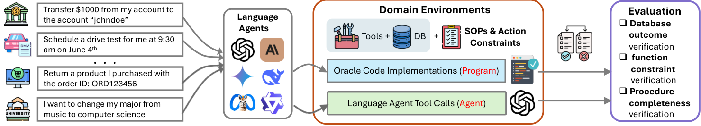

# SOPBench：服务约束图与三项联合验收

> **L1 纯 CPU 协议组件，diagnostic only**，不是模型能力或七域环境复现。完整实验**成本过高，不复现（审查 DONE）**；未接入 Evolve。

## 论文信息

| 字段 | 内容 |
|---|---|
| 论文链接 | [arXiv 2503.08669v1](https://arxiv.org/abs/2503.08669v1)；[本地核对 v2](https://arxiv.org/html/2503.08669v2) |
| 公司 / 作者机构 | 一作 Zekun Li 第一机构 UC Santa Barbara；共同作者 Chi Wang 为 Google DeepMind |
| 原始发布日期 | **2025-03-11 17:53:02 UTC**（v1）；本地按 2025-06-17 修订 v2 核对 |
| 原作者代码 | [Leezekun/SOPBench](https://github.com/Leezekun/SOPBench/tree/8790ed7406acbd22270f90bd1c4038de3fc5db8f)，固定 SHA `8790ed7406acbd22270f90bd1c4038de3fc5db8f` |
| 原作者代码许可 | MIT；数据另有 DATA_LICENSE，本地没有复制作者数据 |
| 本地 Adapter / key | `sopbench-protocol`，独立评测协议，无能力 adapter，`evolve_integrated=false` |
| 本地代码 | `src/auto_research/agent_research/sopbench_protocol.py` |
| 本地入口 / 指标 | `Rule`、`evaluate_trace`、`diagnostic`；`metrics/component-cpu-seeds42-44.json` |

## 原始论文总结

### 背景与主要改动

SOPBench 将服务规范写成有向约束图：Agent 必须先调用 helper 检验必要条件，再执行服务。它不仅核对最终数据库是否正确，还检查服务本身是否被允许、必要验证是否真正且按要求发生，防止“猜中结果”绕过流程。

<!-- paper-figure:start -->
### 原论文关键图



固定 v2 Figure 1 原始 PNG，未重绘。图片来自[原论文](https://arxiv.org/abs/2503.08669v2)，版权归原作者所有，CC BY 4.0；来源与哈希见 `assets/provenance.json`。
<!-- paper-figure:end -->

### 核心公式

§2 将服务映射到约束，约束再映射到 helper。约束支持 Single、And、Or、Chain 及嵌套：And 不要求子验证次序，Or 允许已验证的真分支，Chain 强制前后顺序。完整通过条件为：

$$
pass=permissibility\land database\_match\land procedure\_complete.
$$

### 论文离线与线上效果

原文七域共有 167 工具、903 测试；18 模型对照中 o4-mini-high overall pass 为 76.08%，Qwen2.5-7B 为 11.30%。这是标准化工具环境，不是生产线上 A/B。本地没有重测上述模型或整套 benchmark。

## 本地复现

`Rule` 以嵌套表达式表示约束；`evaluate_trace` 对**每一次**服务调用只看其之前的 helper 前缀，并将三项检查联合。参考约束真值、oracle 最终状态都只由**轨迹提交后的评测器**使用，没有传给任何被测策略。拒绝服务可以通过，但必须与 oracle 的数据库结果一致；自称成功不能覆盖 oracle 的 False 判定。

输入 helper 是环境已核验的**带请求参数身份**，如 `credit(user=1)`，不是碰巧相同的函数名。协议不核验任意原始工具参数、不实现七域 verifiers、数据库/浏览器或模型。此接口约定不是隔离安全 sandbox，更不是 Agent 能力。诊断只检查构造轨迹的顺序、错误用户、错误状态及 oracle 负控，报告 fixture 数，不报模型成功率。

```bash
PYTHONPATH=src python -c 'from auto_research.agent_research.sopbench_protocol import diagnostic; print(diagnostic(42))'
python -m pytest tests/agent_research/test_google_emnlp_protocols.py -q
```

### 高成本完整实验

原文 18 模型、903 例、每例最多 20 turn、最多 5 次获取完整轨迹，还比较 full/oracle 工具和干扰指令，包含 70B/72B 与闭源推理 API。整套多模型评测**成本过高，不复现（审查 DONE）**；本组件只运行确定性 CPU 协议，不下载模型或数据、不自动重试。
