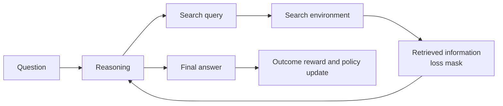
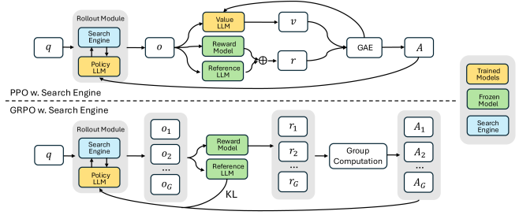

<!-- source-sha256: 94da20d367467c02698dda006661b6b4ec5e81ee3fe8241936b268c8930b5f3b -->

[简体中文](README.md) · English

# Search-R1: Training an agent to interleave reasoning and search with RL

> Implements multi-turn reasoning/search transitions, a loss mask for retrieval tokens and outcome reward. Uses deterministic ScaleMCP-mini, not the paper's E5 index or Qwen training.

## Paper information

| Field | Details |
| --- | --- |
| Paper | [Search-R1: Training LLMs to Reason and Leverage Search Engines with Reinforcement Learning](https://arxiv.org/abs/2503.09516) |
| Institution | UIUC / UMass Amherst / Google Cloud AI Research |
| First public release | 2025-03-12 |
| Author code | [PeterGriffinJin/Search-R1](https://github.com/PeterGriffinJin/Search-R1). |
| Local adapter or method key | `search-r1` |
| Local reproduction code | [`src/auto_research/agent_research/`](https://github.com/daiwk/auto-research/tree/main/src/auto_research/agent_research) |

## Original paper summary

### Background and main changes

One-shot RAG cannot adjust queries after seeing intermediate evidence. Search-R1 treats a search engine as an environment. The model emits search actions during reasoning and resumes when documents return. PPO/GRPO loss applies only to model-generated tokens; retrieved tokens are masked and a simple outcome reward scores the final answer.



<!-- paper-figure:start -->
### Key figure from the paper

[](https://arxiv.org/html/2503.09516/x1.png)

> **Figure 1:** Multi-turn model interaction with the search engine during PPO/GRPO rollout. From the [paper](https://arxiv.org/abs/2503.09516); copyright belongs to the authors. Click for the source.
<!-- paper-figure:end -->

### Core equations

$$
\max_{\pi_\theta}\;
\mathbb E_{x,y\sim\pi_\theta(\cdot|x;\mathcal R)}[r(x,y)]
-\beta D_{\mathrm{KL}}
\left(\pi_\theta(\cdot|x;\mathcal R)\Vert\pi_{\mathrm{ref}}(\cdot|x;\mathcal R)\right),
$$

Tokens returned by retrieval are not policy actions, so their loss mask is zero.

### Offline and online results

Across seven QA datasets, Qwen2.5-7B, Qwen2.5-3B and Llama3.2-3B improve by about 26%, 21% and 10% over matched RAG baselines. No production A/B.

## Local reproduction

```bash
auto-research agent-eval --method search-r1 \
  --benchmark scalemcp-mini --episodes 120 --seed 42
```

| Metric | Search-R1 |
|---|---:|
| Joint success | 1.0000 |
| Average cost | 2.7500 |
| Search queries | 240 |
| Masked retrieved tokens | 1800 |
| Outcome policy updates | 120 |

Stable metrics: [`classic-agentic-rl-opd-seed42.json`](../../experiments/classic-agentic-rl-opd-seed42.json).

## Scope

Retrieved results in the mini-suite are deterministic task context, suitable for checking the interleaved state machine and mask. No web index, Qwen weight updates or seven QA benchmarks. Local success is not comparable to paper EM.
