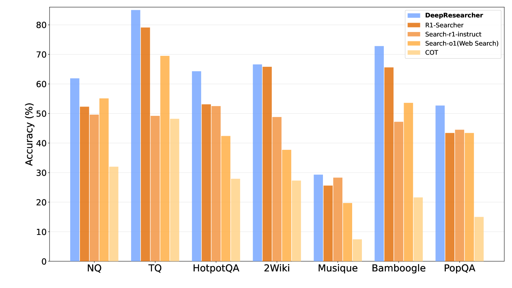

# DeepResearcher: Long-Trajectory RL in Search Environments

<!-- source-sha256: 304ce8915140f3bc11fec646f4063c317393f70372ff0a916ff7140bf51b4da8 -->

[简体中文](README.md)

> **Core mechanism evidence.** Paper and local evaluations are separate.

## Paper information

| Field | Value |
| --- | --- |
| Paper | [DeepResearcher (arXiv 2504.03160)](https://arxiv.org/abs/2504.03160) |
| Affiliations | HKU / GAIR |
| First public release | 2025-04-04 (arXiv v1) |
| Authors' code | [Author code](https://github.com/GAIR-NLP/DeepResearcher). |
| Adapter / method | `deepresearcher` |
| Local code | [`src/auto_research/agent_research/`](https://github.com/daiwk/auto-research/tree/main/src/auto_research/agent_research/) |

## Original paper

### Background and contribution

Treat searching, browsing, collecting evidence, and citing answers as one trajectory. Train with joint answer and citation reward.


<!-- paper-figure:start -->
### Key figure from the paper

[](https://ar5iv.labs.arxiv.org/html/2504.03160/assets/x1.png)

Original Figure 1: DeepResearcher. From the [paper](https://arxiv.org/abs/2504.03160); copyright belongs to the authors. Not a local result.
<!-- paper-figure:end -->

### Core mechanism

$$
R=R_{answer}+\lambda_cR_{citation}-\lambda_qN_{query},\quad\max_\pi\mathbb E_{\tau\sim\pi}R(\tau).
$$

### Paper results

The paper exceeds prompting and SFT baselines on GAIA and WebWalkerQA. No production A/B.

## Local reproduction

PlanBench mini, 120 episodes, seed 42: joint success 1.0000, average cost 1.5000, nonzero method telemetry. [Metrics](../../experiments/global-p0-20260808-seed42.json).

```bash
auto-research agent-eval --method deepresearcher --benchmark planbench-mini --episodes 120 --seed 42
auto-research evolve --model agent --dataset planbench-mini --direction "Combine deepresearcher with installed paper operators" --generations 2 --population 4
```

## Reproduction limits

Mechanism and fixed-budget protocol only; no original LLM, multi-card training, private or real browsing environment, or full benchmark.
