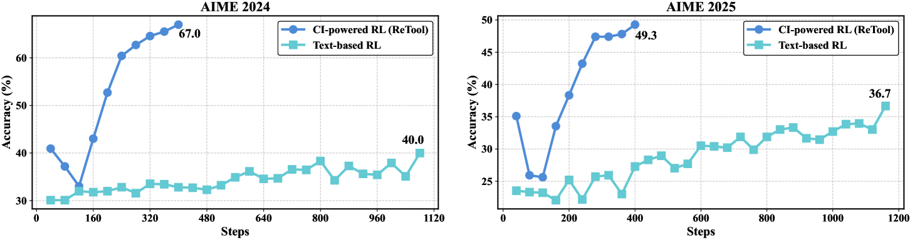

# ReTool: Learn when to use tools during reasoning

<!-- source-sha256: 11042db2fadf131078841973f3a662bf7139a294f6889433a29ec7a0c8ae7605 -->

[简体中文](README.md)

> Core mechanism in a deterministic mini-suite, not the full benchmark.

## Paper information

| Field | Details |
|---|---|
| Paper | [ReTool (arXiv 2504.11536)](https://arxiv.org/abs/2504.11536) |
| Institution | ByteDance Seed. |
| First public release | 2025-04-15 (arXiv v1) |
| Author code | No official author repository found or released. |
| Local adapter or method key | `retool` |
| Local reproduction code | [`src/auto_research/agent_research/`](https://github.com/daiwk/auto-research/tree/main/src/auto_research/agent_research/) |

## Paper method and evidence

Alternate natural-language reasoning and executable tool actions. Use execution feedback to learn tool invocation, correction and stopping.


<!-- paper-figure:start -->
### Original paper figure

[](https://ar5iv.labs.arxiv.org/html/2504.11536/assets/x1.png)

The original figure shows reasoning interleaved with tool calls. From the [original paper](https://arxiv.org/abs/2504.11536); copyright remains with the authors.
<!-- paper-figure:end -->

### Core equation

$$
\tau=(z_1,a_1,o_1,\ldots),\quad R=R_{answer}-c\sum_t\mathbf1[a_t=tool],\quad\max_\pi\mathbb E[R].
$$

### Reported results

The paper reports gains over no-tool and fixed-call baselines on math and tool-augmented tasks. No production A/B.

## Local reproduction

PlanBench mini-suite, 120 episodes, seed 42: joint success **1.0000**, mean cost **1.0500**, and nonzero method-specific telemetry.

```bash
auto-research agent-eval --method retool --benchmark planbench-mini --episodes 120 --seed 42
auto-research evolve --model agent --dataset planbench-mini --direction "Combine retool with installed paper operators" --generations 2 --population 4
```

[Fixed metrics](../../experiments/global-p0-20260808-seed42.json). Validates method-specific objective, state updates and matched budgets only, not large models, multi-GPU RL, private environments, real web or full benchmarks.
