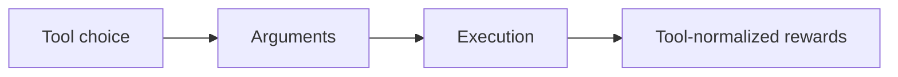
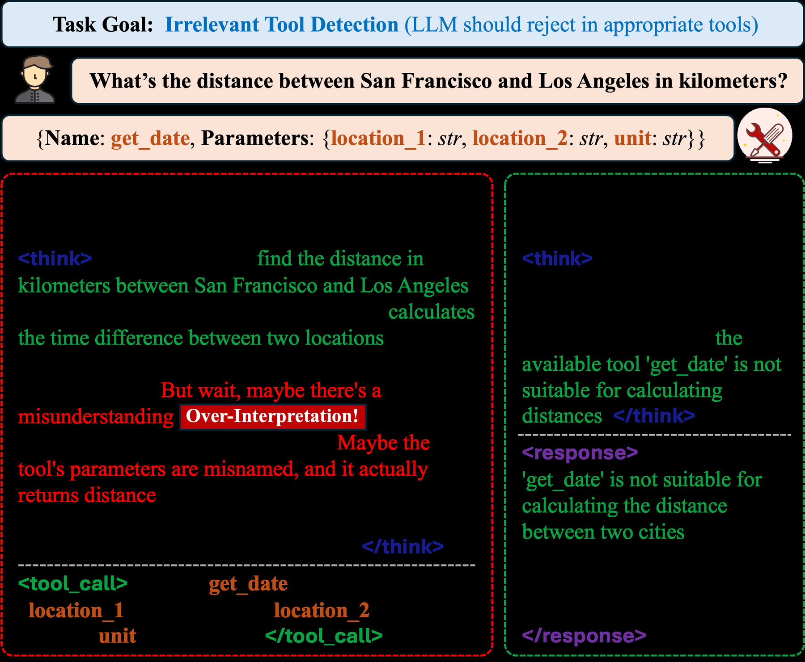

# ToolRL: Multi-Tool Learning with Execution Rewards

<!-- source-sha256: 73074839af8d72e7f0fec01248fc2226cec3c1f46a585778b934360bf2041a64 -->

[简体中文](README.md)

> **Core mechanism evidence.** Paper and local evaluations are separate.

## Paper information

| Field | Value |
| --- | --- |
| Paper | [ToolRL (arXiv 2504.13958)](https://arxiv.org/abs/2504.13958) |
| Affiliations | University of Illinois Urbana-Champaign |
| First public release | 2025-04-16 (arXiv v1) |
| Authors' code | No official author repository found or released. |
| Adapter / method | `toolrl` |
| Local code | [`src/auto_research/agent_research/`](https://github.com/daiwk/auto-research/tree/main/src/auto_research/agent_research/) |

## Original paper

### Background and contribution

Jointly optimize tool selection, arguments, and execution results. Dynamic reward scaling mixes tools of different difficulty within an RL batch.



<!-- paper-figure:start -->
### Key figure from the paper

[](https://ar5iv.labs.arxiv.org/html/2504.13958/assets/figures/introduction.png)

Original Figure 1: ToolRL. From the [paper](https://arxiv.org/abs/2504.13958); copyright belongs to the authors. Not a local result.
<!-- paper-figure:end -->

### Core mechanism

$$
R=R_{select}+R_{args}+R_{exec}+R_{answer},\quad\hat A=(R-\mu_{tool})/(\sigma_{tool}+\epsilon).
$$

### Paper results

The paper improves tool choice, arguments, and final success on multi-tool benchmarks. No production A/B.

## Local reproduction

PlanBench mini, 120 episodes, seed 42: joint success 1.0000, average cost 1.1250, nonzero method telemetry. [Metrics](../../experiments/global-p0-20260808-seed42.json).

```bash
auto-research agent-eval --method toolrl --benchmark planbench-mini --episodes 120 --seed 42
auto-research evolve --model agent --dataset planbench-mini --direction "Combine toolrl with installed paper operators" --generations 2 --population 4
```

## Reproduction limits

Only the mechanism and budget protocol; no paper-scale LLM, distributed RL, private environments, real web, or full benchmark.
