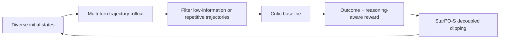
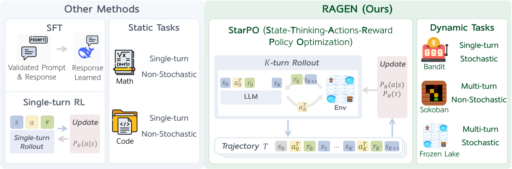

<!-- source-sha256: 380004007b9778e401a42905aaf4331a6f16d43bc391e371a934bc633cd85c1d -->

[简体中文](README.md) · English

# RAGEN: Stable multi-turn reinforcement learning for agents

> **Fidelity:** Implements StarPO-S trajectory rollouts, degenerate trajectory filtering, a critic baseline, reasoning-aware rewards, Echo Trap probes, and decoupled clipping diagnostics.

## Paper information

| Field | Details |
| --- | --- |
| Paper | [RAGEN: Understanding Self-Evolution in LLM Agents via Multi-Turn Reinforcement Learning](https://arxiv.org/abs/2504.20073) |
| Institution | Northwestern / Stanford / Microsoft / UW / NYU / UBC / SMU |
| First public release | 2025-04-24 |
| Author code | [RAGEN-AI/RAGEN](https://github.com/RAGEN-AI/RAGEN) |
| Local adapter or method key | `ragen` |
| Local reproduction code | [`src/auto_research/agent_research/`](https://github.com/daiwk/auto-research/tree/main/src/auto_research/agent_research) |

## Original paper summary

### Background and main changes

Single-turn math RL optimizes one response, whereas agents make decisions over multiple turns in stochastic environments. RAGEN introduces StarPO, which organizes states, thinking, actions, and rewards into full trajectories. The paper observes an Echo Trap in which reward variance suddenly collapses with a gradient spike. StarPO-S uses trajectory filtering, a critic baseline, gradient stabilization, and decoupled clipping to suppress this self-reinforcing repetition.



<!-- paper-figure:start -->
### Key figure from the paper

[](https://arxiv.org/html/2504.20073v2/x1.png)

> **Figure 1:** A comparison between single-turn generation RL and StarPO with multi-turn interaction in stochastic environments. From the [paper](https://arxiv.org/abs/2504.20073); copyright belongs to the authors. Click for the source.
<!-- paper-figure:end -->

### Core equations

$$
J_{\mathrm{StarPO}}(\theta)
=\mathbb E_{\tau\sim\pi_{\theta_{\mathrm{old}}}}
\left[
\min\left(r_\theta(\tau)A(\tau),
\operatorname{clip}(r_\theta(\tau),1-\epsilon_-,1+\epsilon_+)A(\tau)\right)
\right].
$$

StarPO-S filters trajectories by uncertainty and quality before they enter the objective, and stabilizes the critic and gradients separately.

### Offline and online results

The paper systematically studies stability in Bandit, Sokoban, FrozenLake, and WebShop. It reports that StarPO-S mitigates the Echo Trap and substantially improves over an untrained policy in symbolic environments and WebShop. It also notes that SFT still beats RL on some tasks. No production online A/B test is reported.

## Local reproduction

```bash
auto-research agent-eval --method ragen \
  --benchmark planbench-mini --episodes 120 --seed 42
```

| Metric | RAGEN / StarPO-S |
|---|---:|
| Joint success | 1.0000 |
| Average cost | 1.6000 |
| Trajectory rollouts / filtered | 480 / 120 |
| Critic baseline updates | 120 |
| Echo Trap probes / gradient clips | 19 / 19 |

Stable metrics: [`classic-agentic-rl-opd-seed42.json`](../../experiments/classic-agentic-rl-opd-seed42.json).

## Scope

The local policy selects and executes plans from deterministic candidate trajectories without updating LLM weights. Echo Trap events are fixed-frequency stability probes, not the paper's training curves. WebShop and the original game environments are not run.
