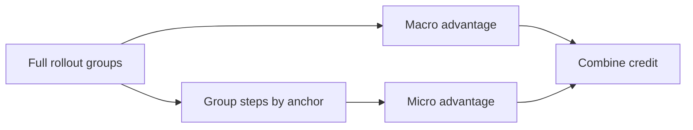
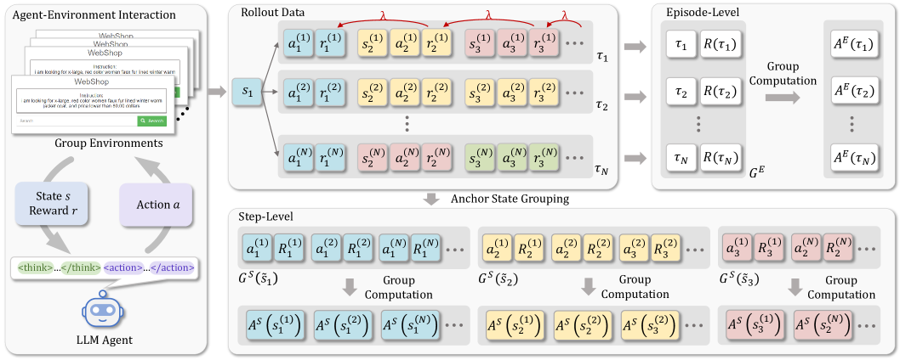

# GiGPO: Group-in-group relative advantages for agents

<!-- source-sha256: 04e545cea1c7a5927b091ffd5108a2d424a1af6d1d473e9ecf5a3c0af5894075 -->

[简体中文](README.md)

> Isolated RL credit mechanism on a deterministic agent mini-suite.

## Paper information

| Field | Details |
|---|---|
| Paper | [GiGPO (arXiv 2505.10978)](https://arxiv.org/abs/2505.10978) |
| Institution | Nanyang Technological University / Skywork AI. |
| First public release | 2025-05-16 |
| Author code | No official author code found. |
| Local adapter or method key | `gigpo` |
| Local reproduction code | [`src/auto_research/agent_research/`](https://github.com/daiwk/auto-research/tree/main/src/auto_research/agent_research/) |

## Paper method and evidence

Sparse final rewards and whole-trajectory relative advantages cannot distinguish useful environment steps. Compute a macro advantage across full trajectories and a micro advantage across steps sharing an anchor state.



<!-- paper-figure:start -->
### Original paper figure

[](https://ar5iv.labs.arxiv.org/html/2505.10978/assets/x2.png)

The original figure contrasts trajectory and step credit. From the [original paper](https://arxiv.org/abs/2505.10978); copyright remains with the authors.
<!-- paper-figure:end -->

### Core equation

$$
A^{\rm GiGPO}_{t}=A^{\rm macro}(\tau)+A^{\rm micro}(s_t,a_t),\quad A^{\rm micro}=r(s_t,a_t)-\operatorname{mean}_{a\in\mathcal G(s_t)}r(s_t,a).
$$

### Reported results

The paper reports gains over GRPO on ALFWorld, WebShop, and search-augmented QA, including over 12% on ALFWorld and 9% on WebShop. No online A/B.

## Local reproduction

Explicitly construct full trajectory groups and step groups in PlanBench mini and record inter-/intra-group advantages, rollout, and turn credit.

```bash
auto-research agent-eval --method gigpo --benchmark planbench-mini --episodes 120 --seed 42
```

[Fixed-seed summary](../../experiments/rl-papers-summary-seed42.json). Deterministic tasks have no real cross-trajectory environment-state convergence; shared plan steps serve as auditable anchors.
