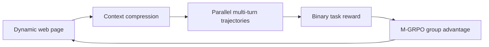
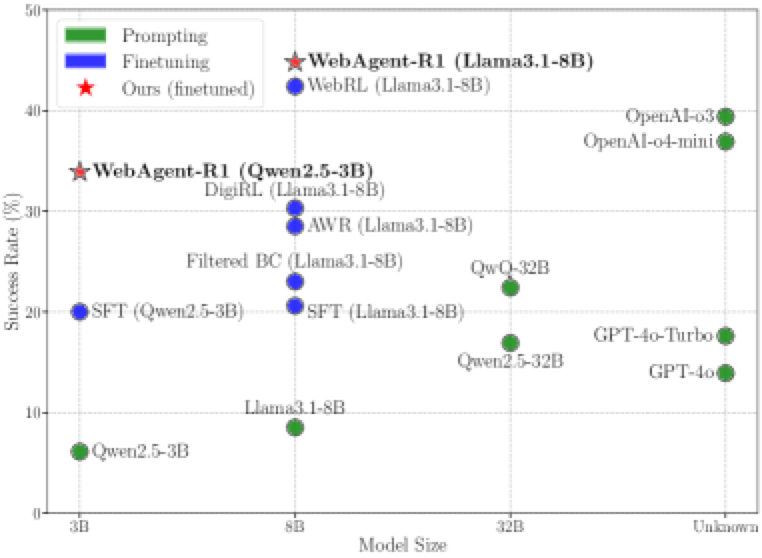

# WebAgent-R1: end-to-end multi-turn reinforcement learning for web agents

<!-- source-sha256: 9ff823af344f6529700f8e0adf4320a852f3348c06207df5201a71569c2c61ea -->

[简体中文](README.md)

> **Fidelity:** Implements dynamic context compression, parallel complete trajectories, binary outcome reward, and multi-turn group-relative updates. The deterministic mini-suite is not WebArena-Lite.

## Paper information

| Field | Details |
|---|---|
| Paper | [WebAgent-R1: Training Web Agents via End-to-End Multi-Turn Reinforcement Learning](https://arxiv.org/abs/2505.16421) |
| Organization | University of Virginia / Amazon / Georgia Tech |
| First public release | 2025-05-22 |
| Authors' code | [weizhepei/WebAgent-R1](https://github.com/weizhepei/WebAgent-R1) |
| Adapter / method | `webagent-r1` |
| Local reproduction code | [`src/auto_research/agent_research/`](https://github.com/daiwk/auto-research/tree/main/src/auto_research/agent_research) |

## Original paper

### Motivation and method

Web interaction accumulates HTML and historical actions; single-turn GRPO cannot handle changing state. WebAgent-R1 dynamically retains recent and task-relevant context, collects full multi-turn trajectories in parallel, and uses M-GRPO to update relative to group rewards for final success. The paper also emphasizes behavior-cloning warm-up and long chain-of-thought initialization.



<!-- paper-figure:start -->
### Key figure from the paper

[](https://arxiv.org/html/2505.16421v2/x1.png)

> **Figure 1:** WebAgent-R1 and web-agent baselines on WebArena-Lite. From the [original paper](https://arxiv.org/abs/2505.16421); copyright remains with the authors.
<!-- paper-figure:end -->

### Core equations

$$
\hat A_i=\frac{R_i-\operatorname{mean}(R_{1:G})}
{\operatorname{std}(R_{1:G})+\epsilon},\qquad
L_{\mathrm{M\text{-}GRPO}}=\mathbb E_{i,t}
\min(\rho_{i,t}\hat A_i,\operatorname{clip}(\rho_{i,t})\hat A_i).
$$

### Paper results

On WebArena-Lite, Qwen2.5-3B success rises from `6.1%` to `33.9%` and Llama3.1-8B from `8.5%` to `44.8%`. No production online A/B is reported.

## Local reproduction

```bash
auto-research agent-eval --method webagent-r1 \
  --benchmark scalemcp-mini --episodes 120 --seed 42
```

| Metric | Local result |
|---|---:|
| Joint success | 1.0000 |
| Average cost | 2.6000 |
| Compressed context tokens | 360 |
| Parallel groups / M-GRPO updates | 120 / 120 |

See the [stable metrics](../../experiments/omitted-agentic-rl-opd-seed42.json).

## Reproduction boundaries

The local environment returns deterministic text-tool observations. There is no browser DOM, web side effect, or Qwen/Llama weight update. The run checks multi-turn rollouts, compression, and group rewards only.
