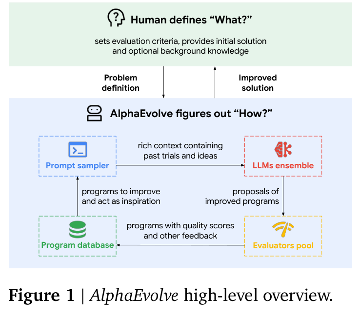
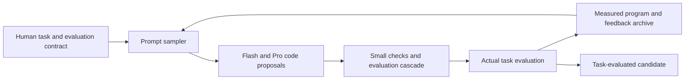

# AlphaEvolve: Closing the Loop Between Program Proposals, Evaluation, and an Evolutionary Archive

<!-- source-sha256: 26aa215ad685d1a70d49041d3417204d5ba1049d98234341e9607f73abd8ac09 -->

[简体中文](README.md)

> Historical algorithm-discovery / RSI research backfill; `deferred_high_cost`. **Not reproduced because of high cost; review DONE.** Source and cost review only: no local AlphaEvolve controller, mathematical discoveries, or Evolve integration.

## Paper Information

| Field | Value |
| --- | --- |
| Paper | [arXiv 2506.13131v1](https://arxiv.org/abs/2506.13131v1); [fixed text](https://arxiv.org/html/2506.13131v1) |
| Company / institution / university | First author Alexander Novikov and the author team share the Google DeepMind affiliation, checked against v1 PDF page 1 |
| First public release | 2025-06-16 06:37:18 UTC for arXiv v1. The earlier [May 14, 2025 announcement](https://deepmind.google/blog/alphaevolve-a-gemini-powered-coding-agent-for-designing-advanced-algorithms/) introduces the system but is not this white paper's exact submission timestamp |
| Author source code | [google-deepmind/alphaevolve_results](https://github.com/google-deepmind/alphaevolve_results) publishes mathematical constructions and correctness-checking notebooks. Its README explicitly excludes the code to run AlphaEvolve. Community OpenEvolve is not the authors' system |
| Local adapter | None; literature key `alphaevolve`; `adapter: null` |
| Local reproduction code | None: this write-up, bilingual learning questions, and catalog metadata only. A construction verifier is not a research agent |

## Original Paper Summary

<!-- paper-figure:start -->
### Key Figure from the Paper

Source: [v1 PDF, page 3, Figure 1](https://arxiv.org/pdf/2506.13131v1#page=3), cropped from the original, not redrawn. The division between humans defining what and the system exploring how does not establish autonomous specification or verification of all scientific objectives.

Image from the [original paper](https://arxiv.org/abs/2506.13131v1); copyright belongs to its authors. Full-system or experimental results shown are not local component results.
<!-- paper-figure:end -->

### Background and Main Changes

Humans specify a task, initial program, and evaluator. A prompt sampler combines a parent, previously successful constructions, and feedback; Gemini 2.0 Flash/Pro propose code edits, which evaluation nodes actually execute. Programs with multidimensional scores enter an evolutionary database that preserves both quality and diversity. Controller, proposal workers, and evaluation pools run asynchronously for aggregate throughput. [Sections 2.1–2.6](https://arxiv.org/html/2506.13131v1#S2)

### Core Formula

Section 2.1 fixes a user-provided evaluator returning one or more **measured** metrics:

$$
h:P\longrightarrow\mathbb{R}^{m},\qquad
p'=\operatorname{LLM}(p,\mathrm{context}(\mathcal D)).
$$

Section 2.4 allows a cascade: cheap small-scale checks precede expensive tests for promising candidates. Separate LLM feedback can score qualities such as simplicity, but does not replace functional correctness. Section 2.5 draws on MAP-Elites and island populations. The paper does not fully disclose a unique archive, migration, or sampling implementation; filling the gaps with a heuristic would not reproduce the official system.

### Original Offline and Online Results

The authors report a rank-48 construction for **complex** 4-by-4 matrix multiplication versus recursive Strassen's 49 scalar multiplications; this is not rank 48 over every field. Roughly 75% of their mathematical cases match known constructions and roughly 20% improve them. Section 3.3 also reports improvements to Google's scheduling, TPU circuits, compiler, and Gemini training kernels, with production adoption. Not every case is a randomized traffic A/B experiment. [Section 3](https://arxiv.org/html/2506.13131v1#S3)

This repository has not discovered those constructions, rerun production systems, or validated mathematical scores. Checking one published construction also does not execute the search that discovered it.

## Local Review and Boundaries

### Source Verification

We read fixed-v1 task, proposal, evaluation, evolution, and distributed-pipeline sections, inspected the original figure, and checked the official results repository. Its notebook verifies results rather than implementing the controller. Independent OpenEvolve implementations are not Google's original. No models, large repository clone, notebook execution, or paid LLM calls were used.

### High-Cost Full Experiment

Section 2.4 permits approximately **100 compute-hours** to evaluate a new candidate, distributed over an evaluation cluster. This is a supported scale, not a fixed average for every candidate. Mathematical searches, multiple initializations, and production-specific hardware optimization in Section 3 additionally require heterogeneous data, toolchains, and internal infrastructure; proposal generation uses Gemini 2.0 Flash/Pro.

The complete system's compute, external-model, and unavailable-controller requirements exceed a short one-A100/A30 or Mac budget. It is **not reproduced because of high cost; review DONE**. No large search is attempted, toy MAP-Elites substitute, metrics, executable Evolve integration, or automatic retry is added.
