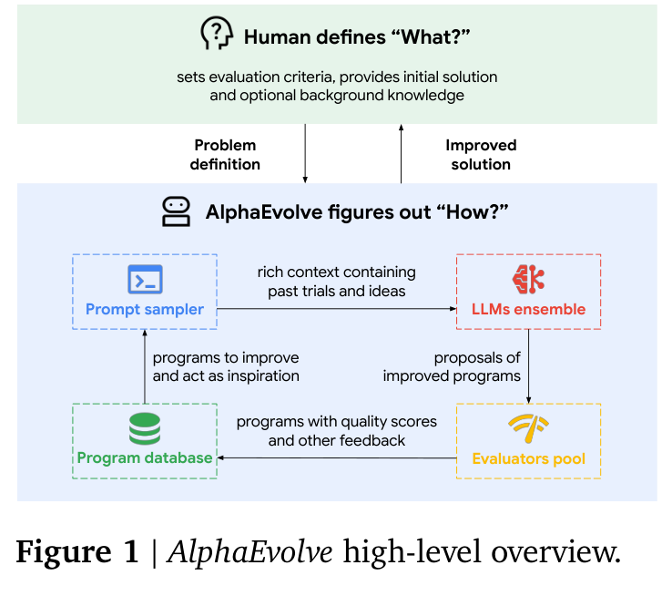

# AlphaEvolve：让程序提案、自动评价与进化档案形成闭环

> 经典算法发现 / RSI 相关研究补漏；`deferred_high_cost`。**成本过高，不复现（审查 DONE）**。仅资料与成本审查，没有本地 AlphaEvolve 控制器、数学发现结果或 Evolve 集成。

## 论文信息

| 字段 | 内容 |
| --- | --- |
| 论文链接 | [arXiv 2506.13131v1](https://arxiv.org/abs/2506.13131v1)；[固定正文](https://arxiv.org/html/2506.13131v1) |
| 公司 / 机构 / 学校 | 一作 Alexander Novikov 等，全部作者统一署名 Google DeepMind；已核对 v1 PDF 首页 |
| 首次公开日期 | 2025-06-16 06:37:18 UTC（arXiv v1）；[2025-05-14 官方公告](https://deepmind.google/blog/alphaevolve-a-gemini-powered-coding-agent-for-designing-advanced-algorithms/)更早介绍系统，不冒充该白皮书的精确提交时间 |
| 原作者代码 | [google-deepmind/alphaevolve_results](https://github.com/google-deepmind/alphaevolve_results) 发布发现的数学构造与正确性检查 notebook；README 明确**不包含运行 AlphaEvolve 的代码**。社区 OpenEvolve 等不是作者原系统 |
| 本地 Adapter | 无；文献 key：`alphaevolve`；`adapter: null` |
| 本地复现代码 | 无本地复现；仅本页、双语学习问答与目录元数据，不把上游构造验证器当作科研 Agent |

## 原始论文总结

<!-- paper-figure:start -->
### 原论文关键图

来源：[v1 PDF 第 3 页 Figure 1](https://arxiv.org/pdf/2506.13131v1#page=3)，截取原图，未重绘。图中“人类定义什么、系统探索如何实现”的分工，不代表系统能够独立定义或验证所有科学目标。

图片来自[原论文](https://arxiv.org/abs/2506.13131v1)，版权归原作者所有；图中完整系统或实验结果不等于本地组件结果。
<!-- paper-figure:end -->

### 背景与主要改动

AlphaEvolve 把有自动评价器的算法改进问题写成程序进化：人类给出任务、初始程序和评价函数，提示采样器提供待改程序、已有高分构造及反馈；Gemini 2.0 Flash/Pro 混合提出代码修改，再由评估节点实际执行。带多维分数的程序进入进化数据库，为下一轮保留高质量和多样化材料。整个控制器、提案节点与评估池异步运行，以整体吞吐而非单次响应速度为目标。[§2.1–2.6](https://arxiv.org/html/2506.13131v1#S2)

### 核心公式

§2.1 由用户固定评价函数，返回一个或多个**实际测得**的指标：

$$
h:P\longrightarrow\mathbb{R}^{m},\qquad
p'=\operatorname{LLM}(p,\mathrm{context}(\mathcal D)).
$$

§2.4 允许评价级联：候选先过便宜的小规模检查，足够有希望才继续更贵的测试；也可添加独立 LLM 对简洁性等属性的反馈，但不应把它等同功能正确性。§2.5 的数据库借鉴 MAP-Elites 与 island population，兼顾质量与多样性；论文没有把全部档案、迁移和采样超参数公开成唯一可逐行照搬的算法，不能自行补一个启发式后称为官方实现。

### 论文离线与线上效果

作者报告发现 4×4 **复数矩阵**乘法的 rank-48 构造，较递归 Strassen 的 49 次标量乘法少一次；不能改写为任意域上的通用 rank-48 结论。数学任务中约 75% 匹配已有最佳构造、约 20% 改进；这些是原文任务集合口径。§3.3 另报告 Google 调度、TPU 电路、编译器与 Gemini 训练核的改进，并描述生产采用；不把所有案例统称为随机流量 A/B。[§3](https://arxiv.org/html/2506.13131v1#S3)

本库没有生成这些构造、复测生产系统或验证数学成绩。独立检查一个已公布构造，也不能证明运行了发现该构造的进化系统。

## 本地审查与边界

### 来源核验

已阅读固定 v1 的任务、提案、评价、进化与分布式流程，核对原图和官方结果仓库。上游 notebook 是结果及验证材料，不是控制器源码；OpenEvolve 等独立实现也不等于 Google 原版。没有下载模型、克隆大仓库、运行 notebook 或调用付费 LLM。

### 高成本完整实验

§2.4 明确允许对一个新候选投入约 **100 compute-hours** 的评价，并以评估集群并行缩短墙钟；这是系统可使用的量级，不是每个候选的固定平均成本。§3 的数学搜索、多初值训练与生产硬件优化还依赖不同数据、工具链和内部基础设施，提案本身使用 Gemini 2.0 Flash/Pro。

完整系统的算力、外部模型及未公开控制器门槛超出单张 A100/A30 或本地 Mac 的短时预算，故**成本过高，不复现（审查 DONE）**。不试跑大搜索、不以玩具 MAP-Elites 代替缺失的系统，不生成指标、不接入可执行 Evolve，也不进入自动重试队列。
