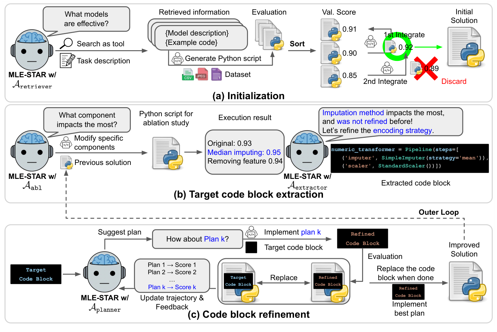
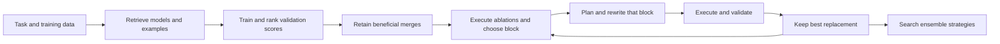

# MLE-STAR: Retrieve Models, Then Refine the Code Blocks That Matter

<!-- source-sha256: 0e19c6eefc25b30757aba285ba8a67cc663f771b9a9300611b0066d15ed854fe -->

[简体中文](README.md)

> Historical autonomous-ML research backfill; `deferred_high_cost`. **Not reproduced because of high cost; review DONE.** No local agent, training result, executable operator, or Evolve integration.

## Paper Information

| Field | Value |
| --- | --- |
| Paper | [arXiv 2506.15692v1](https://arxiv.org/abs/2506.15692v1); [fixed text](https://arxiv.org/html/2506.15692v1) |
| Company / institution / university | First author Jaehyun Nam, Google Cloud and KAIST; PDF page 1 states that the work was done during a Google Cloud student-research placement. Jinsung Yoon, Jiefeng Chen, Sercan Ö. Arık, and Tomas Pfister are affiliated with Google Cloud |
| First public release | **2025-05-27 18:11:25 UTC**, cross-checked against arXiv submission history, citation_date, and the v1 PDF. Do not infer the month from identifier `2506` |
| Author source code | [jaehyun513/MLE-STAR](https://github.com/jaehyun513/MLE-STAR) exposes generated solutions and intermediate artifacts, not proof of a complete controller release. The [official Google blog](https://research.google/blog/mle-star-a-state-of-the-art-machine-learning-engineering-agents/) also links an [ADK sample](https://github.com/google/adk-samples/tree/main/python/agents/machine-learning-engineering); its exact raw README path returned 404 in this check, so a current complete implementation was not independently verified |
| Local adapter | None; literature key `mle-star`; `adapter: null` |
| Local reproduction code | None: this write-up, bilingual learning questions, and catalog metadata only. An upstream sample is not a locally executed implementation |

## Original Paper Summary

<!-- paper-figure:start -->
### Key Figure from the Paper

Source: [v1 PDF, page 4, Figure 2](https://arxiv.org/pdf/2506.15692v1#page=4), cropped from the original, not redrawn. Training, validation, and code edits shown belong to the authors' system, not a local execution trace.

Image from the [original paper](https://arxiv.org/abs/2506.15692v1); copyright belongs to its authors. Full-system or experimental results shown are not local component results.
<!-- paper-figure:end -->

### Background and Main Changes

Whole-script rewriting can keep an LLM tied to familiar models and make it switch prematurely between preprocessing, model choice, and tuning. MLE-STAR retrieves task-specific models and example code, trains candidates, ranks validation performance, and retains a merge only when it improves the solution. Executed ablations then identify a high-impact block not already targeted. Inner loops plan, rewrite, and evaluate that block; an outer loop chooses the next block. Ensemble search and leakage/data-use checks are separate agents. [Sections 3.1–3.4](https://arxiv.org/html/2506.15692v1#S3)

### Core Formula

Section 3 and Appendix B evaluate **complete candidate solutions**, not the plausibility of descriptions. With fixed validation procedure $h$, the greedy retention rule can be summarized as:

$$
c_{k+1}=\operatorname{Coder}(b,p_k),\qquad
s_k=\operatorname{Replace}(s,b,c_{k+1}),
$$
$$
s_{\mathrm{best}}\leftarrow s_k
\quad\text{only if}\quad h(s_k)>h(s_{\mathrm{best}}).
$$

Block $b$ comes from executed ablations and plan $p_k$ uses prior execution feedback. The inequality assumes a higher-is-better metric. Inner comparisons change the selected block; outer iterations choose another. Fixed scripts, hand-entered scores, or text similarity in place of training do not execute the defining algorithm.

### Original Offline and Online Results

Fixed v1 Section 4.1/Table 1 reports **43.9%** Any Medal for MLE-STAR with Gemini-2.0-Flash versus **25.8%** for same-model AIDE across 22 MLE-bench Lite Kaggle competitions and three independent trials. These are authors' offline results, not local scores or production A/B evidence. The later official blog's approximately 63% belongs to a subsequent version/configuration and does not overwrite v1.

## Local Review and Boundaries

### Source Verification

We reviewed v1 methods, algorithms, and resource configuration, checked the original affiliation/date, and retained the original figure. The author repository's `example_final_solutions` and `example_intermediate_outputs` are generated artifacts; their presence does not establish release of the complete orchestration/search/auditing controller. No Kaggle data, external LLM calls, or example executions were used.

### High-Cost Full Experiment

Appendix F specifies **96 vCPUs, 360 GB RAM, and eight 16 GB V100 GPUs**, a 24-hour task cap, and **14.1 hours** on average per final solution across 22 competitions and three trials. Retrieval, repeated model training, and ensembling add work. These are published configurations and measurements, not local timings. One A100/A30 or Mac should not launch this matrix merely to demonstrate its cost.

The full experiment is therefore **not reproduced because of high cost; review DONE**. No automatic retry, fabricated metrics, or executable Evolve operator is added. Any future small controller must separately state missing real training, ablations, and semantic decisions rather than claim MLE-STAR reproduction.
