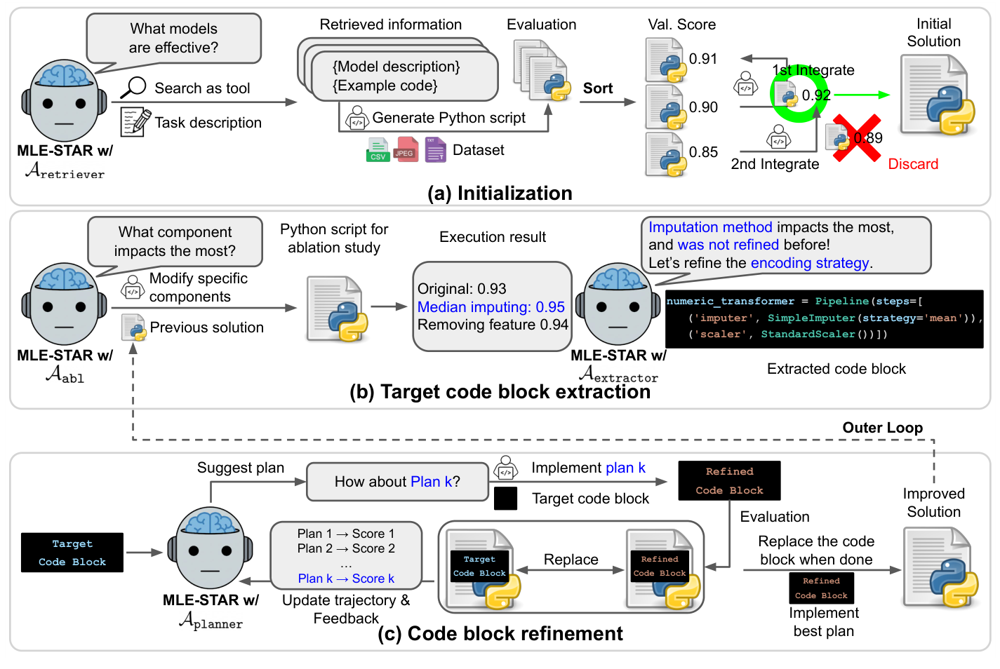

# MLE-STAR：先检索模型，再用消融定位值得改的代码块

> 经典自主机器学习研究补漏；`deferred_high_cost`。**成本过高，不复现（审查 DONE）**。本页没有本地 Agent、训练结果、可执行算子或 Evolve 接入。

## 论文信息

| 字段 | 内容 |
| --- | --- |
| 论文链接 | [arXiv 2506.15692v1](https://arxiv.org/abs/2506.15692v1)；[固定正文](https://arxiv.org/html/2506.15692v1) |
| 公司 / 机构 / 学校 | 一作 Jaehyun Nam，Google Cloud 与 KAIST；PDF 首页注明工作在 Google Cloud 学生研究期间完成。Jinsung Yoon、Jiefeng Chen、Sercan Ö. Arık、Tomas Pfister 署名 Google Cloud |
| 首次公开日期 | **2025-05-27 18:11:25 UTC**，按 arXiv 提交历史、citation_date 与 v1 PDF 首页交叉核对；不按标识中的 `2506` 推断月份 |
| 原作者代码 | [jaehyun513/MLE-STAR](https://github.com/jaehyun513/MLE-STAR) 可核到生成方案和中间产物目录；不是完整控制器发布证明。[Google 官方博客](https://research.google/blog/mle-star-a-state-of-the-art-machine-learning-engineering-agents/)另链接 [ADK 示例](https://github.com/google/adk-samples/tree/main/python/agents/machine-learning-engineering)，本轮该示例 raw README 返回 404，未独立核实当前完整源码 |
| 本地 Adapter | 无；文献 key：`mle-star`；`adapter: null` |
| 本地复现代码 | 无本地复现；仅本页、双语学习问答与目录元数据，不把上游示例当成本库已执行实现 |

## 原始论文总结

<!-- paper-figure:start -->
### 原论文关键图

来源：[v1 PDF 第 4 页 Figure 2](https://arxiv.org/pdf/2506.15692v1#page=4)，截取原图，未重绘。图中的训练、验证与改码属于作者系统，不是本地执行轨迹。

图片来自[原论文](https://arxiv.org/abs/2506.15692v1)，版权归原作者所有；图中完整系统或实验结果不等于本地组件结果。
<!-- paper-figure:end -->

### 背景与主要改动

直接让 LLM 重写整份训练脚本，容易一直使用熟悉的旧模型，又在数据处理、模型选择和调参之间反复跳转。MLE-STAR 先从网络检索任务相关模型与示例代码，实际训练候选并按 validation 指标排序，再逐个尝试合并，只有改进才保留。随后执行消融，找出影响最大且尚未重点细化的代码块；对这个块做多轮计划、改写和训练评估，再把最佳替换写回完整方案。外层循环重新定位下一块，另有独立的集成策略搜索与数据泄漏/数据使用检查。[§3.1–3.4](https://arxiv.org/html/2506.15692v1#S3)

### 核心公式

原文 §3 与 Appendix B 中的关键约束是**评价完整候选方案**，不是给语言描述打分。用 $h$ 表示固定的验证流程，可概括其贪心保留条件：

$$
c_{k+1}=\operatorname{Coder}(b,p_k),\qquad
s_k=\operatorname{Replace}(s,b,c_{k+1}),
$$
$$
s_{\mathrm{best}}\leftarrow s_k
\quad\text{only if}\quad h(s_k)>h(s_{\mathrm{best}}).
$$

这里 $b$ 是由真实消融结果定位的目标代码块，$p_k$ 是依据此前执行反馈生成的新计划；指标统一为越大越好时使用上述不等式。内层比较只改变目标块，外层才重新选块。取固定脚本、手填验证分或用字符串相似度代替训练，都没有执行论文的中心算法。

### 论文离线与线上效果

固定 v1 的 §4.1/Table 1 报告：在 MLE-bench Lite 的 22 个 Kaggle 竞赛、三次独立运行中，Gemini-2.0-Flash 的 MLE-STAR Any Medal 为 **43.9%**，同模型 AIDE 为 **25.8%**。这些是作者离线竞赛结果，不是本地成绩，也不是生产 A/B。后续官方博客的约 63% 来自后续版本/配置，不能覆盖本页固定 v1 的口径。

## 本地审查与边界

### 来源核验

本轮阅读 v1 的方法、算法和资源配置，核对 PDF 首页机构与提交历史，并保留原图。作者仓库的 `example_final_solutions`、`example_intermediate_outputs` 是生成产物；目录存在不证明发布了完整编排、搜索或审计控制器。未下载 Kaggle 数据、未调用外部 LLM、未执行这些脚本。

### 高成本完整实验

Appendix F 给出 **96 vCPU、360 GB 内存、8 张 16 GB V100**；每竞赛上限 24 小时，22 个竞赛乘三次运行的单个最终方案平均耗时 **14.1 小时**，还包含模型检索、反复训练与集成。以上均为原文配置/测量，不是本地计时。单张 A100/A30 或 Mac 不应启动完整矩阵来“试证”成本。

因此完整实验**成本过高，不复现（审查 DONE）**；不进入自动重试队列，不生成伪指标，不注册可执行 Evolve 算子。未来若另行实现小型调度合同，也必须把真实训练/消融与外部语义决策的缺失单独标明，不能凭控制流宣称复现 MLE-STAR。
