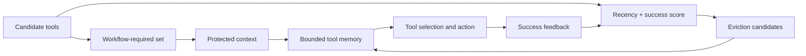
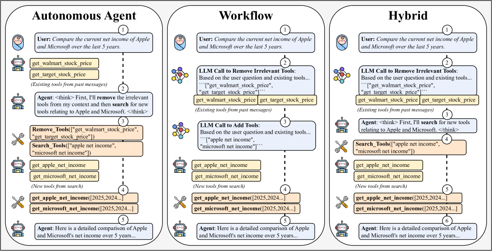

<!-- source-sha256: d51f7cf7709ac20008ebfbdcf72f2503c579c6ee21bdc2e0091d9b62086a3f4b -->

[简体中文](README.md) · English

# MemTool: Dynamic tool memory under context limits

> **Fidelity:** Implements hybrid tool memory, workflow protection, and dynamic eviction. ScaleMCP mini tests multi-turn tool-set management only, without 5,000 real MCP servers.

## Paper information

| Field | Details |
| --- | --- |
| Paper | [MemTool (arXiv 2507.21428)](https://arxiv.org/abs/2507.21428) |
| Institution | PricewaterhouseCoopers Commercial Technology and Innovation Office |
| First public release | 2025-07-29 |
| Author code | No public repository found on the paper page as of 2026-07-27. |
| Local adapter or method key | `memtool` |
| Local reproduction code | [`src/auto_research/agent_research/`](https://github.com/daiwk/auto-research/tree/main/src/auto_research/agent_research) |

## Original paper summary

### Background and main changes

Many MCP tool descriptions quickly fill the context window; static truncation can drop tools required for the current workflow. MemTool compares autonomous, workflow, and hybrid management. The hybrid policy protects tools required by the current workflow and dynamically evicts other tools based on recency and historical success.



<!-- paper-figure:start -->
### Key figure from the paper

[](https://ar5iv.labs.arxiv.org/html/2507.21428/assets/x1.png)

> **Figure 1:** The core architecture, its main modules, and their connections. From the [paper](https://arxiv.org/abs/2507.21428); copyright belongs to the authors. Click for the source.
<!-- paper-figure:end -->

### Core equations

Each unprotected tool $j$ receives a retention score. Evict the lowest-scoring one:

$$
s_j=\lambda\,\mathrm{recency}_j
+(1-\lambda)\,\mathrm{success}_j,\qquad
j^\star=\arg\min_{j\notin\mathcal{T}_{\mathrm{required}}}s_j.
$$

The workflow set $\mathcal{T}_{\mathrm{required}}$ always takes precedence over heuristic eviction.

### Offline and online results

The paper evaluates over 13 LLMs with 5,000 MCP servers and 100 consecutive ScaleMCP interactions. Autonomous reasoning models remove about 90%–94% of tools. Workflow and hybrid management compress context effectively; autonomous and hybrid management are best for completion. No production online A/B test is reported.

## Local reproduction

`scalemcp-mini` generates sequential tool requirements. Under a fixed memory size, it updates the protected set, evicts nonessential tools, and records task success, context cost, and `tool_evictions`.

```bash
auto-research agent-eval --method memtool \
  --benchmark scalemcp-mini --episodes 120 \
  --memory-size 8 --seed 42
```

| Metric | MemTool |
|---|---:|
| Joint success | 1.0000 |
| Average cost | 1.9812 |
| Tool evictions | 200 |
| Tool memory size | 8 |

Stable metrics: [`agent-mini-suites-seed42.json`](../../experiments/agent-mini-suites-seed42.json).

## Scope

Tools are deterministic local descriptions, with no real MCP network latency, permission failures, or model tool-choice errors. Results support the bounded-context eviction logic and metrics pipeline, not a direct comparison with the paper's 5,000-server experiment.
