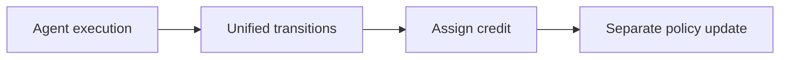
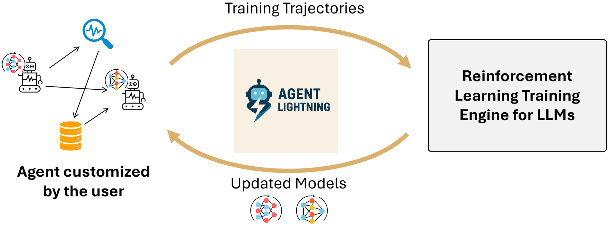

# Agent Lightning

<!-- source-sha256: 88baa5a31b38f5ab1099242151d513f0dafe5340c3852e144e001321ae05fc66 -->

[简体中文](README.md)

> Controlled code-agent transition and policy-memory mechanism, not LightningRL over LLM weights.

## Paper information

| Field | Details |
|---|---|
| Paper | [Agent Lightning: Train ANY AI Agents with Reinforcement Learning](https://arxiv.org/abs/2508.03680) |
| Institution | Microsoft Research. |
| First public release | 2025-08-05 |
| Author code | [microsoft/agent-lightning](https://github.com/microsoft/agent-lightning). |
| Local adapter or method key | `agent-lightning` |
| Local reproduction code | `src/auto_research/agent_research/` |

## Paper method and evidence

Decouple execution from training. Log interactions as unified MDP transitions and assign credit to pieces of a long trace, rather than concatenating everything into one framework-specific sequence.



<!-- paper-figure:start -->
### Original paper figure

[](https://ar5iv.labs.arxiv.org/html/2508.03680/assets/figures/overview.png)

The original figure shows the training/execution architecture. From the [original paper](https://arxiv.org/abs/2508.03680); copyright remains with the authors.
<!-- paper-figure:end -->

### Core equation

$$
G_t=\sum_{k=t}^{T}\gamma^{k-t}r_k,\qquad
\nabla J(\theta)=\mathbb E[\nabla\log\pi_\theta(a_t|s_t)A_t].
$$

### Reported results

The paper reports sustained gains on text-to-SQL, RAG, and mathematical tool use, with low-intrusion integration across agent frameworks. No production A/B.

## Local reproduction

Commands, edits and tests form transitions. Real exit codes are rewards; assign failed credit to the patch and store verified fixes by bug family for reuse.

```bash
auto-research agent-eval --method agent-lightning \
  --benchmark swebench-local --episodes 12 --memory-size 8 --seed 42
```

[Stable metrics](../../experiments/agent-code-sandbox-seed42.json). Local updates affect a controlled patch policy, not LLM parameters.
