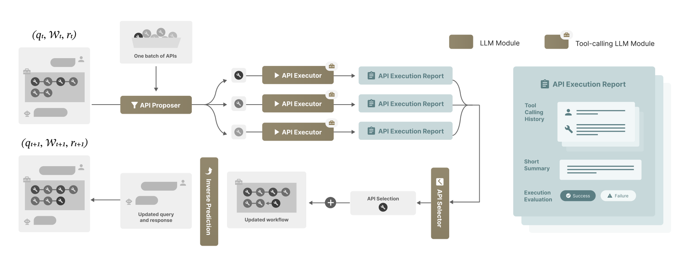

# ToolGrad: Efficient Tool-Use Dataset Generation with Textual Gradients

<!-- source-sha256: 5ef5efe10df5ae5573289493285b909e51efc0f64c98027aa504b0d0c9486c0d -->

[简体中文](README.md)

> **Local core-mechanism evidence.** Paper outcomes and local results are separate.

## Paper information

| Field | Value |
| --- | --- |
| Paper | [ToolGrad: Efficient Tool-Use Dataset Generation with Textual Gradients](https://arxiv.org/abs/2508.04086) |
| Affiliations | Google, first author's affiliation |
| First public release | 2025-08-06 |
| Authors' code | [Authors' code](https://github.com/zhongyi-zhou/toolgrad). |
| Adapter / method | `toolgrad` |
| Local code | [`src/auto_research/agent_research/latest_20260914.py`](https://github.com/daiwk/auto-research/blob/main/src/auto_research/agent_research/latest_20260914.py) |

## Original paper

### Background and contribution

Work backward from a target answer to propose tool traces, then use textual gradients to locate and revise failed calls, reducing manual annotation.

<!-- paper-figure:start -->
### Key figure from the paper

Original Figure 2: ToolGrad. From the [paper](https://arxiv.org/abs/2508.04086); copyright belongs to the authors. Not a local result.
<!-- paper-figure:end -->

### Core mechanism

The deterministic reference edits failing calls, deduplicates traces, and exposes selection and state statistics for boundary tests.

### Paper results

ToolGrad-12B scores 83.1 on BFCL versus Gemini 2.5 Pro's 83.2, as reported in the paper. No local benchmark or inferred online gain.

## Local reproduction

[Three-seed metrics](metrics/mechanism-seeds42-44.json) use matched fixtures and budgets. The deterministic reference exposes edit/dedup behavior and tests its boundaries.

## Reproduction limits

L1 answer-first and deduplicated textual edits only. No 12B training or BFCL run.
