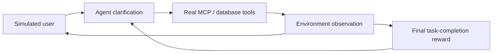
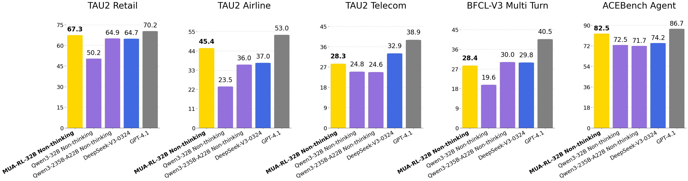

# MUA-RL: bringing dynamic users into reinforcement learning for tool-using agents

<!-- source-sha256: 1cecc56db59011b1cd8bb4772f57f1c5f0c5744258a89300acccf74dd4e22662 -->

[简体中文](README.md)

> **Fidelity:** Implements multi-turn simulated-user feedback, progressive intent clarification, actual tool observations, environment-token masks, and rewards based only on final completion. This is a deterministic tool mini-suite.

## Paper information

| Field | Details |
|---|---|
| Paper | [MUA-RL: Multi-turn User-interacting Agent Reinforcement Learning for agentic tool use](https://arxiv.org/abs/2508.18669) |
| Organization | Meituan / Chinese Academy of Sciences / Peking University |
| First public release | 2025-08-26 |
| Authors' code | [zzwkk/MUA-RL](https://github.com/zzwkk/MUA-RL) |
| Adapter / method | `mua-rl` |
| Local reproduction code | [`src/auto_research/agent_research/`](https://github.com/daiwk/auto-research/tree/main/src/auto_research/agent_research) |

## Original paper

### Motivation and method

Tool-use RL typically fixes the user request, but real users revise requirements in response to the agent. MUA-RL places an LLM-simulated user inside the rollout. The agent clarifies intent in conversation and calls real MCP or database tools. User messages and tool results do not contribute to policy loss; exploration uses only the final task-completion reward.



<!-- paper-figure:start -->
### Key figure from the paper

[](https://arxiv.org/abs/2508.18669)

> **Figure 1:** Overall MUA-RL results on several multi-turn tool benchmarks. Copyright remains with the authors.
<!-- paper-figure:end -->

### Core equation

$$
J(\theta)=\mathbb E_{\tau\sim\pi_\theta,\;u\sim\pi_{\mathrm{user}}}
\left[R_{\mathrm{task}}(\tau)\right],
$$

User messages and tool responses are environment tokens and excluded from policy-token loss.

### Paper results

MUA-RL-32B scores `67.3/45.4/28.3` on TAU2 Retail/Airline/Telecom, `28.4` on BFCL-V3 Multi Turn, and `82.5` on ACEBench Agent. No production online A/B is reported.

## Local reproduction

```bash
auto-research agent-eval --method mua-rl \
  --benchmark scalemcp-mini --episodes 120 --seed 42
```

| Metric | Local result |
|---|---:|
| Joint success | 1.0000 |
| Average cost | 2.2500 |
| Simulated-user turns / intent refinements | 360 / 240 |
| Tool responses / final rewards | 360 / 120 |

See the [stable metrics](../../experiments/omitted-agentic-rl-opd-seed42.json).

## Reproduction boundaries

Local simulated users reveal constraints deterministically from task context; tools return actual mini-suite states. There is no external LLM user or production database. This tests interaction and reward boundaries, not original model scale.
