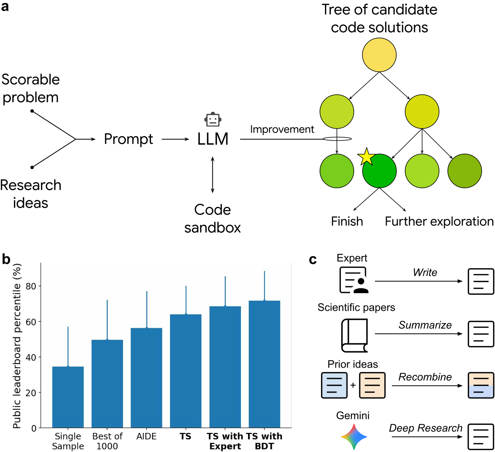

<!-- source-sha256: 6c2ea882fd2d0189a3f932a02a12113bd35aacaaa0f97d59e80501116b5f6ef3 -->
# ERA: Flat PUCT for improving empirical software

[简体中文](README.md)

## Paper information

| Field | Value |
| --- | --- |
| Paper | [An AI system to help scientists write expert-level empirical software](https://arxiv.org/abs/2509.06503); local implementation follows [v1 Methods / Algorithm 1](https://arxiv.org/html/2509.06503v1#alg1) |
| First-author institution | Eser Aygün, Google DeepMind; collaborators include Google Research |
| Original publication | **2025-09-08 10:08:36 UTC**, arXiv v1; later journal or code updates do not change this date |
| Authors' code | [google-research/era](https://github.com/google-research/era), Apache-2.0. The current repository includes a FUTS example and generated results; distinguish later framework releases from the generated artifacts available with v1 |
| Local adapter / key | `era-flat-puct`; no capability adapter or executable Evolve research agent |
| Local code | `src/auto_research/agent_research/era_flat_puct.py`; tests in `tests/agent_research/test_era_flat_puct.py` |
| Scope | **CPU L1 mechanism component**: v1 flat-PUCT ranking, selection and visits. Full campaign: **not reproduced due to high cost; review DONE** |

## Original paper summary

### Motivation and main changes

ERA gives an LLM a scorable scientific task and existing or proposed research ideas, executes generated programs in an isolated environment, and searches for improvements. It stores evaluated code in a tree and balances quality with exploration when choosing the next program to mutate. Its scientific studies cannot be replaced by a small arithmetic example.

Unlike recursive root-to-child MCTS, **every evaluated node competes directly**. A deep node can be expanded immediately. Nodes retain externally measured task scores rather than backed-up descendant rollout averages. External literature search, human filtering and idea recombination belong to the full system, not this arithmetic kernel.

<!-- paper-figure:start -->
### Key figure from the paper



Figure 1 from the [original paper](https://arxiv.org/html/2509.06503v1#Sx1.F1), rendered proportionally from its SVG on a white background. Copyright remains with the original authors. Plotted performance is authors' evidence, not local reproduction.
<!-- paper-figure:end -->

### Core equations

For $n$ candidates, let $r_T(u)$ be ascending rank of the externally measured validation score:

$$
R_T(u)=\frac{r_T(u)-1}{n-1},\quad P_T(u)=\frac1n,\quad N=\sum_{v\in T}V(v).
$$

For the singleton tree, v1 specifies $R_T(u)=1$. Selection considers the **whole tree**:

$$
u^*=\arg\max_{u\in T}\left[R_T(u)+c_{puct}P_T(u)\frac{\sqrt N}{1+V(u)}\right].
$$

Algorithm 1 initializes root and new-child visits to one and increments only the child's ancestors. Final selection uses raw task score, not the exploration bonus. Average ranks for tied scores and identity-order selection ties are **explicit local conventions unspecified by the paper**. The current upstream example may use different singleton and root-initialization conventions; this module follows fixed v1, not a claim of identical later code.

## Data protocol and code mapping

`Candidate` contains an opaque program identity, an external evidence reference and a maximization-oriented **validation** score. Callers explicitly orient error metrics and own split isolation and independent evaluation. The kernel never reads test data. `FlatPUCT.run` invokes external `generate_and_execute(parent)` exactly within its iteration budget.

No generated code is executed, no sandbox is established, and no Gemini or data resources are fetched. Evidence references are not truth-checked. Types cannot detect a caller passing test scores as validation scores; controlled execution and split isolation remain prerequisites for capability comparisons.

## Local reproduction

```bash
PYTHONPATH=src:scripts python scripts/run_nov13_history_components.py --check
python -m pytest tests/agent_research/test_era_flat_puct.py
```

Three-seed artifacts are in `metrics/component-cpu-seeds42-44.json`; the shared runner checks frozen code, raw results and metrics. Seeds vary explicit score fixtures, not independent scientific tasks. Tests cover singleton rank, total visits, flat priors, ancestor updates, direct deep-node selection, ties, zero budget and invalid scores. Passing supports only `l1_mechanism / diagnostic_only`, not scientific performance or Evolve promotion.

### Authors' offline and online evidence

The authors report gains on OpenProblems.bio, COVID forecasting and GIFT-Eval. Executable scoring adds constraints, but task selection, injected research ideas and hyperparameter search still affect fair comparison; original validation/test splits must remain intact. This is not an industrial recommendation production A/B study. It is included as a general scientific-research Agent paper without invented online gains.

## Reproduction limits

### Full-campaign cost and limits

Methods reports 500-node single-cell searches taking roughly seven hours each, 2,000-node COVID searches, per-dataset searches for 92 GIFT-Eval datasets and a separate unified search exceeding 1,000 nodes. These use external LLM calls, generated-code execution and repeated evaluation. Timings are **authors' measurements**, not local measurements or current API prices.

Under the one-A100/A30 or local-Mac budget, the full matrix is **not reproduced due to high cost; review DONE**. No trial training, large downloads, paid API calls or automatic retries are launched. The CPU kernel has no CUDA path, so no GPU receipt is fabricated.
