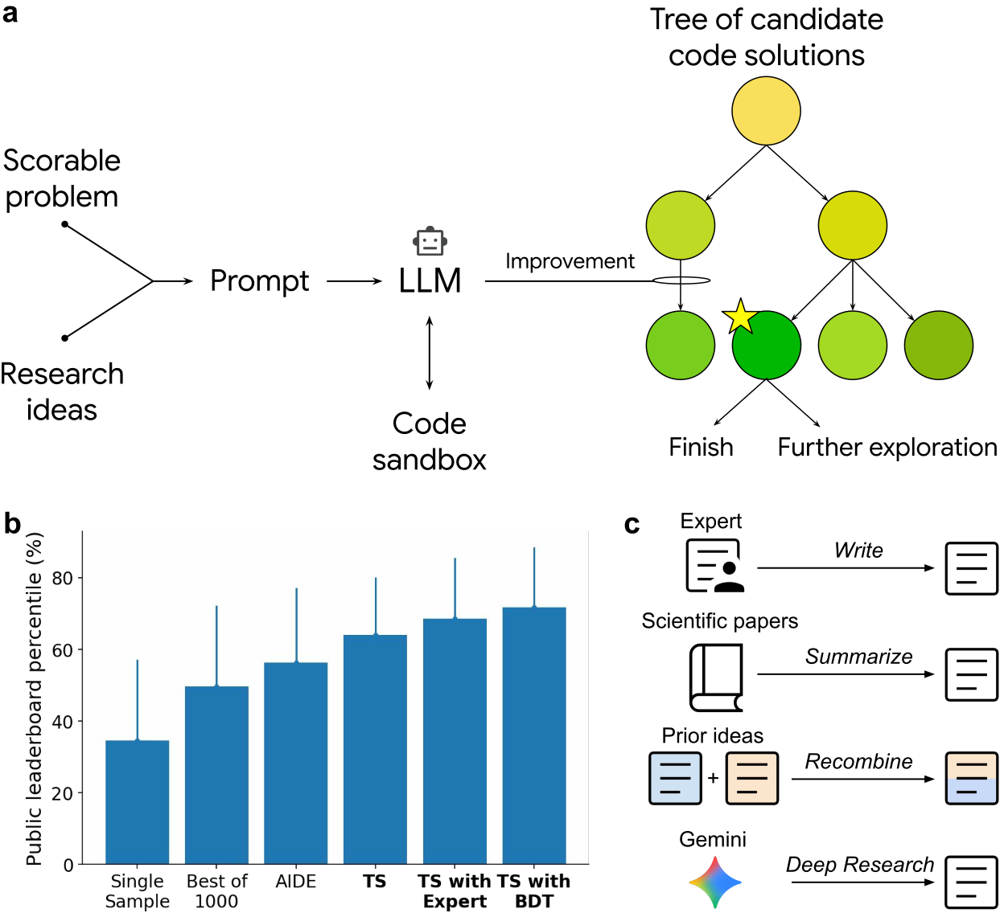

# ERA：以平铺 PUCT 搜索改进科研软件

[English](README-en.md)

## 论文信息

| 字段 | 内容 |
| --- | --- |
| 论文链接 | [An AI system to help scientists write expert-level empirical software](https://arxiv.org/abs/2509.06503)，本地核对 [v1 Methods / Algorithm 1](https://arxiv.org/html/2509.06503v1#alg1) |
| 公司 / 机构 | 一作 Eser Aygün：Google DeepMind；合作作者来自 Google Research 等机构 |
| 首次公开日期 | **2025-09-08 10:08:36 UTC**（arXiv v1；不把后续期刊或开源更新算成新论文） |
| 原作者代码 | 是，[google-research/era](https://github.com/google-research/era)，Apache-2.0；当前仓库包含 FUTS 示例及生成结果。v1 的生成代码产物与后续发布的框架实现须区分 |
| 本地 adapter / key | `era-flat-puct`；无能力 adapter，不能作为已接入 Evolve 的研究 Agent |
| 本地复现代码 | `src/auto_research/agent_research/era_flat_puct.py`；测试 `tests/agent_research/test_era_flat_puct.py` |
| 复现范围 | **CPU、L1 机制组件**：v1 平铺 PUCT 的排名、选择和访问计数；完整实验**成本过高，不复现（审查 DONE）** |

## 原始论文总结

### 背景与主要改动

ERA 把可评分的科研任务、已有方法或新研究思路交给 LLM，生成程序后在隔离环境中运行，以任务指标持续搜索改进。关键不是让模型连续改写同一段答案，而是保存已执行代码树，用质量与探索项决定下一个应变异的程序。原文跨单细胞整合、预测、遥感和数值任务评测，不能用一个小算术例替代这些科研结果。

与递归沿根节点选择子树的常见 MCTS 不同，ERA 的 **所有已执行节点同时竞争**；选中深层节点可直接产生新程序。节点保存外部任务分数，不把后代 rollout 均值回传为价值。外部研究思路的检索、人工筛选和重组也是完整系统的一部分，不包含在本地数学核里。

<!-- paper-figure:start -->
### 原论文关键图



图片来自[原论文](https://arxiv.org/html/2509.06503v1#Sx1.F1) Figure 1，由原始 SVG 等比例渲染；版权归原作者所有。图中性能为作者报告，本地未复现。
<!-- paper-figure:end -->

### 核心公式

设树中有 $n$ 个候选，外部验证分数按升序给出排名 $r_T(u)$：

$$
R_T(u)=\frac{r_T(u)-1}{n-1},\quad P_T(u)=\frac1n,\quad N=\sum_{v\in T}V(v).
$$

当 $n=1$ 时原文指定 $R_T(u)=1$。每次从**整个树**选择：

$$
u^*=\arg\max_{u\in T}\left[R_T(u)+c_{puct}P_T(u)\frac{\sqrt N}{1+V(u)}\right].
$$

v1 Algorithm 1 将根和新子节点的访问次数都初始化为 1；增加子节点后，仅沿其祖先链各加 1。最终按原始任务分数选择，而非选择探索奖励最高的程序。本地对同分采用平均排名，对选择同分采用 ID 顺序——这些是**原文未规定的局部确定性约定**。当前上游示例的根初始化与单节点排名约定可能不同，本地明确实现固定 v1，不混称完全相同。

## 数据协议与代码映射

`Candidate` 只接收程序身份、外部证据引用及最大化方向的 **validation** 分数。调用方须对误差类指标显式转换方向，并负责分割隔离和独立评分；本核不读取测试集。`FlatPUCT.run` 通过外部 `generate_and_execute(parent)` 回调接入新候选，严格按迭代预算调用。

本地不执行生成代码、不建立 sandbox、不获取 Gemini 或外部数据，也不证明证据引用真实。若不可信回调把测试分数当验证分数，类型检查无法自动发现；真实能力评测必须另行建立受控执行和数据隔离。

## 本地复现

```bash
PYTHONPATH=src:scripts python scripts/run_nov13_history_components.py --check
python -m pytest tests/agent_research/test_era_flat_puct.py
```

三种子执行产物见 `metrics/component-cpu-seeds42-44.json`；统一 runner 核验冻结源码、原始结果和指标。seed 只改变显式评分夹具，不代表三个独立科研任务。专测覆盖 singleton 排名、总访问次数、平坦先验、祖先更新、深叶直接选择、同分约定、零预算及非法分数。任何通过只支持 `l1_mechanism / diagnostic_only`，不支持论文科研能力排名或 Evolve 晋级。

### 论文离线与线上效果

作者在 OpenProblems.bio、COVID 预测、GIFT-Eval 等任务报告改进。可执行评分器增加了约束，但任务选择、研究思路注入和超参数搜索仍可能影响公平性；必须保留原验证/测试划分。该论文不是工业搜广推上线 A/B，本次按通用科学研究 Agent 主题收录，不伪造线上收益。

## 复现边界

### 高成本完整实验与边界

原文 Methods 报告单细胞实验每次搜索 500 节点、约 7 小时；COVID 每次 2,000 节点，GIFT-Eval 涉及 92 个数据集分别搜索及另一个 1,000 节点以上的统一模型搜索。它们还调用外部 LLM、运行生成代码并反复评测。上述时间是**作者环境中的报告**，不是本地测量或当前 API 报价。

按单张 A100/A30 或本地 Mac 的资源与费用约束，完整矩阵标记**成本过高，不复现（审查 DONE）**，不试训、不下载大资源、不调用付费 API、不自动重试。此 CPU 组件没有 CUDA 路径，故不制造 GPU 回执。
