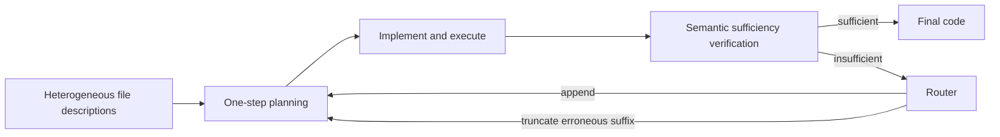
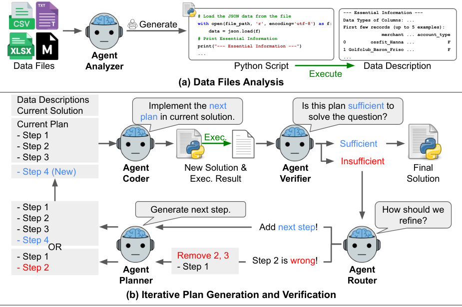

<!-- source-sha256: 7c8778b5eb3689a3f743d83c3ccae61401c0a2da8496347df0e860128994adcb -->
# DS-STAR: verification-driven sequential planning and backtracking

[简体中文](README.md)

> **L1 CPU control kernel, not a complete data-science agent.** Planner, coder/executor, semantic verifier and router are external components. Local code reads no data files, executes no generated code, receives no gold, and does not treat fixed-callback checks as answer capability.

## Paper information

| Field | Value |
| --- | --- |
| Paper | [DS-STAR: Data Science Agent via Iterative Planning and Verification](https://arxiv.org/abs/2509.21825v1), [fixed v1](https://arxiv.org/html/2509.21825v1), [Google publication](https://research.google/pubs/ds-star-data-science-agent-via-iterative-planning-and-verification/) |
| Institution | First author Jaehyun Nam is jointly affiliated with **Google Cloud / KAIST** on the fixed-v1 PDF byline; its footnote states work during a Google Cloud student-researcher appointment. This is not inferred from coauthors |
| Original publication | **2025-09-26 03:38:12 UTC**; a historical repair, not a November 13 first release |
| Original code | [google-research/ds-star](https://github.com/google-research/ds-star), released; inspected HEAD `6c05b01e30f01489af12708e99eda932e44d10ba`. Its current README includes a revised title and DS-STAR+; local components follow v1, not those later claims |
| Local key / adapter | `ds-star`; `adapter=null`; no Evolve integration |
| Local code | `src/auto_research/agent_research/ds_star.py` |

## Original paper

### Motivation and main changes

Data-science questions may span CSV, JSON, Markdown, Excel and other files. A few table rows can miss relevant associations, while executable code need not sufficiently answer the query. DS-STAR first executes file-analysis scripts to obtain descriptions, then starts with a simple step and iteratively plans, implements, executes and verifies.

The verifier sees the query, cumulative plan, code and execution output. If insufficient, the router distinguishes a correct but incomplete plan from a plan containing an erroneous step: append in the former case; remove the erroneous step and its suffix, then generate a new step, in the latter. It does not merely append commentary to an invalid chain. Debugging, final formatting and retrieval over large file collections belong to the full system and are absent locally.

### Architecture



<!-- paper-figure:start -->
### Key original figure

[](https://arxiv.org/html/2509.21825v1/main_ds_star.png)

From the [original paper](https://arxiv.org/html/2509.21825v1#S3.F2); copyright remains with the original authors. This is the official HTML Figure 2 PNG, unchanged, uncropped and not PDF-rendered. Its real file analysis and semantic agents are not locally integrated.
<!-- paper-figure:end -->

### Core equations

Descriptions come from actual analysis-script execution; sufficiency is conditioned on the current code and output:

$$
d_i=\operatorname{exec}(\mathcal A_{analyzer}(\mathcal D_i)),\qquad
v_k=\mathcal A_{verifier}(p,q,s_k,r_k).
$$

When the router identifies step l as erroneous, retain the prefix before it and generate one step:

$$
p\leftarrow(p_0,\ldots,p_{l-1}),\qquad
p_{new}=\mathcal A_{planner}(p,q,r_k,\{d_i\}).
$$

The prose uses human-readable Step 1, whereas Algorithm 1 uses zero-based indices and mixes k with current plan length. The local `Route("backtrack", index)` explicitly uses a **zero-based position in the current plan**. Append retains that full plan rather than deriving its length from the iteration count. The planner still receives the last output and the coder/executor the last code reference; neither guarantees that the output belongs to the retained prefix or that the external coder removed obsolete code correctly.

Algorithm 1 still routes, proposes and executes after the final insufficient verdict. The kernel preserves this result but labels it `exhausted_unverified`. A budget of M verifier calls may produce M+1 executions; the last artifact does not automatically become sufficient.

### Author results

Fixed v1 reports Gemini-2.5-Pro DABStep easy/hard accuracy of 87.50%/45.24%. Hard accuracy falls to 26.98% without file analysis and 39.95% without routing. KramaBench accuracy is 44.69%, versus 39.79% for DA-Agent in the same table. DA-Code hard accuracy is 37.1%, versus 32.0% for the same-model DA-Agent. Different benchmark denominators and difficulties cannot be merged into one success rate; KramaBench's oracle-file setting is not normal retrieval.

These are the authors' full-agent results, not local measurements. No production-user A/B result is reported. Local code runs no commercial LLM, benchmark or real data-science program.

## Local reproduction

### Protocol and code mapping

`Execution` stores external code and output references only; `Verification` requires an explicit sufficiency boolean and reason. `State` supplies query, descriptions, plan and references to the verifier/router. `PlanContext` supplies the retained prefix and last output to the planner, and the new plan and last code to the coder/executor. Nonempty references validate types, not whether execution really occurred.

| Kernel | Implemented scope |
| --- | --- |
| `refine_plan` | Append one step, or remove the named zero-based position and suffix before proposing one replacement; reject invalid indices |
| `run_plan` | Initial step, independent sufficiency verdict, routing, planning, external implementation/execution and finite budgets |
| `diagnostic` | Fixed callback truth tables for data flow, backtracking, stopping and unverified results; no data-science answers |

```bash
PYTHONPATH=src python -c 'from auto_research.agent_research.ds_star import diagnostic; print(diagnostic(42))'
PYTHONPATH=src python -m pytest tests/agent_research/test_ds_star.py -q
```

### Evidence and negative controls

Checks cover suffix removal, replacing the first step, preserving prior steps on append, retaining the last output for planning, passing prior code to the coder, no router call after sufficient, and no success promotion on exhaustion. External exceptions propagate; untyped outputs, ambiguous booleans and invalid indices are rejected. Seeds only reorder fixed routing cases, not capability examples.

The frozen source was actually executed on CPU with seeds 42, 43 and 44 and all control checks passed; see [contract metrics](metrics/component-cpu-seeds42-44.json) and the unified receipt. This is not benchmark accuracy, training or agent-capability measurement. CUDA is explicitly rejected.

## Boundaries

No file analyzer, embedding retriever, LLM planner/verifier/router, generator or Python executor, debugger, finalizer, sandbox or benchmark bridge is supplied. There is no complete-agent or Evolve claim. The external semantic verifier is a central capability gap that a True fixture cannot fill. Gold belongs only in an independent evaluator, never the actor.

### Full experiment and cost

Appendix C reports averages over **10 DABStep development tasks**: **12.7 LLM calls, 154669 input tokens, 3373 output tokens and USD 0.23 per task**, using then-current Gemini-2.5-Pro pricing. This is not large-model training, and multiple agents alone do not make it high-cost. It is neither the total cost of all benchmarks nor a current price quote.

This delivery is a no-API control component. The full three-benchmark commercial-model/data/code-execution evaluation is **not reproduced (dependency/scope limitation; review DONE)**. No weights or commercial probes were used, and no full-run cost is invented. Automatic retry remains disabled.
