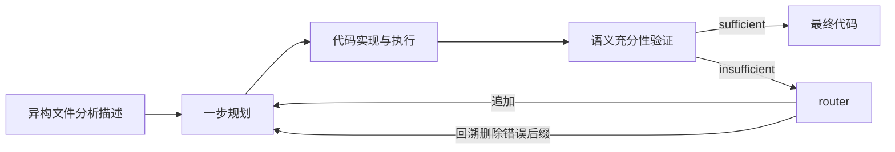
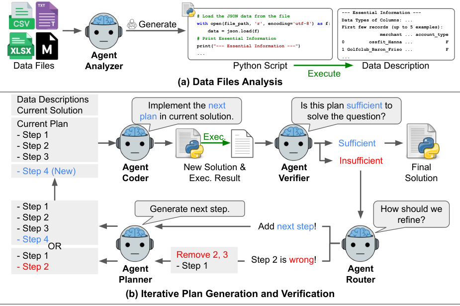

# DS-STAR：验证驱动的逐步规划与回溯

[English](README-en.md)

> **L1 CPU 控制核，不是完整数据科学 Agent。** Planner、coder/executor、语义 verifier 和 router 均由外部提供；本地不读文件、不执行生成代码、不接触 gold，也不把固定回调通过当成答题能力。

## 论文信息

| 字段 | 内容 |
| --- | --- |
| 论文链接 | [DS-STAR: Data Science Agent via Iterative Planning and Verification](https://arxiv.org/abs/2509.21825v1)，[固定 v1](https://arxiv.org/html/2509.21825v1)，[Google 官方条目](https://research.google/pubs/ds-star-data-science-agent-via-iterative-planning-and-verification/) |
| 公司 / 机构 | 一作 Jaehyun Nam，固定 v1 PDF 首页联合署名 **Google Cloud / KAIST**；脚注注明在 Google Cloud 学生研究期间完成。不是由共同作者机构推断 |
| 首次公开日期 | **2025-09-26 03:38:12 UTC**；本轮是历史漏项修复，不是 11/13 首发 |
| 原作者代码 | [google-research/ds-star](https://github.com/google-research/ds-star)，已发布；核对 HEAD `6c05b01e30f01489af12708e99eda932e44d10ba`。当前 README 包含新版题名和 DS-STAR+；本地按 v1，不混用新版声明 |
| 本地 adapter / key | `ds-star`；`adapter=null`；未接入 Evolve |
| 本地复现代码 | `src/auto_research/agent_research/ds_star.py` |

## 原始论文总结

### 背景与主要改动

数据科学问题可能跨 CSV、JSON、Markdown、Excel 等多种文件。只看少量表格行容易丢失关联信息，而脚本能运行也不代表输出足以回答问题。DS-STAR 先生成并执行文件分析脚本，形成描述，再从一个简单步骤开始，逐步规划、实现、执行和判断充分性。

Verifier 同时看 query、累计计划、代码和实际输出。若不足，router 区分“正确但还没做完”与“已有步骤错误”：前者追加；后者删掉错误步骤及其后缀，再采样新步骤。不是把新说明附在错误链条末尾。调试器、格式化 finalizer 和大文件库检索是完整系统的其他组件，本地没有实现它们。

### 架构与流程



<!-- paper-figure:start -->
### 原论文关键图

[](https://arxiv.org/html/2509.21825v1/main_ds_star.png)

图片来自[原论文](https://arxiv.org/html/2509.21825v1#S3.F2)，版权归原作者所有。保存官方 HTML 的 Figure 2 PNG 原始字节，未重画、裁剪或 PDF 渲染；图中的真实文件分析与语义 Agent 并非本地已接入。
<!-- paper-figure:end -->

### 核心公式

文件描述来自实际执行的分析脚本，充分性判断以当前代码及输出为条件：

$$
d_i=\operatorname{exec}(\mathcal A_{analyzer}(\mathcal D_i)),\qquad
v_k=\mathcal A_{verifier}(p,q,s_k,r_k).
$$

若 router 指出第 l 步错误，保留错误之前的前缀再生成一步：

$$
p\leftarrow(p_0,\ldots,p_{l-1}),\qquad
p_{new}=\mathcal A_{planner}(p,q,r_k,\{d_i\}).
$$

正文以 `Step 1` 展示人类步骤，Algorithm 1 则使用零基下标并有 k／当前长度混用。本地接口明确采用 `Route("backtrack", index)` 的**零基当前计划位置**；追加保留完整当前计划，不用迭代次数推测长度。Planner 仍收到上一轮输出，coder/executor 仍收到上一轮 code 引用；这不保证该输出属于保留前缀，也不保证外部 coder 已正确删除错误代码。

按 Algorithm 1，最后一次 insufficient 仍会路由、生成并执行新稿；本地保留这份结果但标 `exhausted_unverified`。M 次 verifier 预算可能有 M+1 次执行，不把最后一稿自动标为 sufficient。

### 论文离线与线上效果

固定 v1 报告 Gemini-2.5-Pro 的 DABStep easy/hard accuracy 为 87.50%／45.24%；去掉文件分析降到 hard 26.98%，去掉 router 降到 39.95%。KramaBench 为 44.69%，对比同表 DA-Agent 39.79%；DA-Code hard 为 37.1%，同模型 DA-Agent 32.0%。不同 benchmark 分母和任务难度不可直接混成一个成功率；KramaBench oracle 文件设置也不是正常检索结果。

这些是作者的完整 Agent 结果，不是本地指标。未报告用户生产流量线上 A/B；本地不运行商业 LLM、benchmark 或真实数据科学代码。

## 本地复现

### 数据协议与代码映射

`Execution` 仅保存外部代码与输出引用，`Verification` 必须给显式布尔充分性与理由。`State` 向 verifier/router 提供 query、描述、计划和引用；`PlanContext` 给 planner 保留前缀及上一输出，给 coder/executor 新计划和上一代码。引用非空只保证类型，不能证明真的执行过。

| 控制核 | 已实现范围 |
| --- | --- |
| `refine_plan` | 追加一步，或删除指定零基位置及其后缀再生成一步；越界拒绝 |
| `run_plan` | 初始一步、独立充分性判断、路由、再规划、外部实现／执行及有限预算 |
| `diagnostic` | 固定回调真值表检查数据流、回溯、停止和未验证结果；不产生分析答案 |

```bash
PYTHONPATH=src python -c 'from auto_research.agent_research.ds_star import diagnostic; print(diagnostic(42))'
PYTHONPATH=src python -m pytest tests/agent_research/test_ds_star.py -q
```

### 结果与负控

检查错误后缀删除、首步可替换、追加保留原步骤、planner 保留最后输出、coder 接收上一代码、sufficient 后不再调用 router、预算耗尽不升级成功。外部异常传播，非类型化输出、模糊真假和非法下标拒绝。Seed 仅改变固定路由测试的排列，不是不同能力样本。

冻结源码已在 CPU 实际执行 seed 42／43／44，控制检查均通过，见 [合同指标](metrics/component-cpu-seeds42-44.json) 与统一冻结回执。它不是 benchmark accuracy、模型训练或 Agent 能力测量。本地只支持 CPU，显式拒绝 CUDA。

## 复现边界

不提供文件分析器、embedding 检索、LLM planner/verifier/router、代码生成或 Python 执行器、调试、finalizer、沙箱及 benchmark bridge；不宣称完整 Agent 或 Evolve 集成。语义 verifier 外置是主要能力缺口，不能由 `True` fixture 假装补齐。评测 gold 只能留在独立 evaluator，不能传入 actor。

### 完整实验与成本

附录 C 在 DABStep **10 个 development 任务**上报告平均每任务 **12.7 次 LLM 调用、154669 输入 token、3373 输出 token、USD 0.23**，使用当时 Gemini-2.5-Pro 定价。这不是大模型训练，也不能因为是多 Agent 就夸成高成本；它不代表所有 benchmark 的总费用或当前价格。

本轮只交付无 API 的控制组件，完整三 benchmark 的商业模型、数据文件与代码执行评测**不复现（依赖／范围限制，审查 DONE）**。没有下载权重、尝试商业探针或虚构完整运行成本；不进入自动重试队列。
