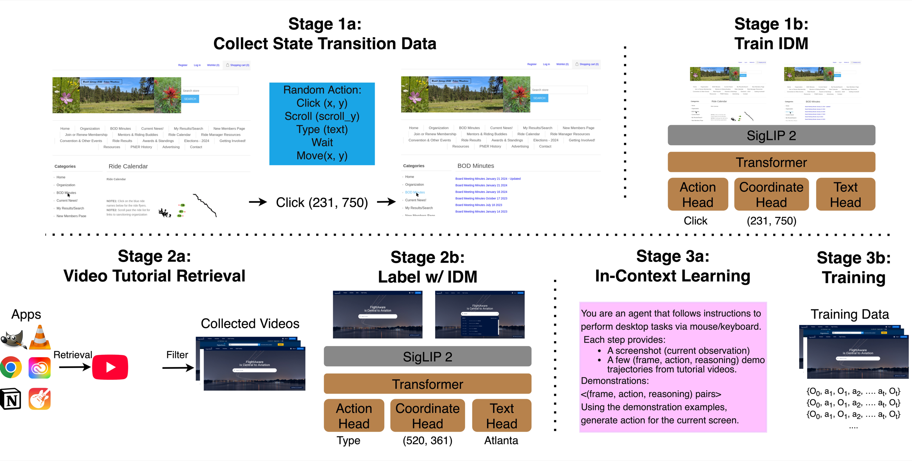
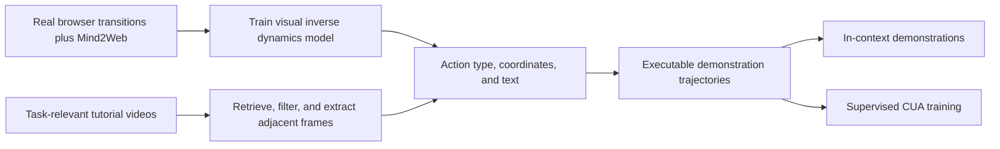

# Watch & Learn: From online videos to computer-use trajectories

<!-- source-sha256: ab32ec9967d8c77a38c6a22c104280dc6aa613e62356ac7005a9ef6286e59590 -->

[简体中文](README.md)

> Historical catalog backfill: not reproduced due to cost (review DONE). This entry has no executable adapter, component metrics, or GPU pass claim, and is not queued for automatic implementation or retry.

## Paper information

| Field | Value |
|---|---|
| Paper | [Watch and Learn: Learning to Use Computers from Online Videos](https://arxiv.org/abs/2510.04673v1) |
| Organization | First author Chan Hee Song: The Ohio State University; collaborators from Google Cloud AI Research and Google DeepMind, as listed on the [author project page](https://chanh.ee/wandl/) |
| First published | **2025-10-06 10:29:00 UTC**, arXiv v1, the version used here for method and cost review. Latest v3 is 2026-03-16; neither the revision nor the Google catalog date is first publication. |
| Original author code | No author code or weights verified. The project page's Code placeholder has no link and does not establish a release. Code SHA and license are not applicable. |
| Adapter | Catalog key `watch-and-learn`; `adapter=null` |
| Local reproduction code | None. Only `src/auto_research/paper_specs/catalog/agent-research/watch-and-learn.json` and review materials. |
| Intake | `historical-directory-backfill`. A Google catalog URL was observed on 2026-10-26; the paper was not newly published then. |

## Original paper summary

### Background and main changes

Watch & Learn frames video action recognition as inverse dynamics: given screen images before and after a transition, predict the action causing it. The trained inverse dynamics model (IDM) annotates online tutorials. Task retrieval turns these annotations into trajectories for in-context demonstrations and supervised computer-use agent (CUA) training. A generic LLM is not asked to guess actions, and rules do not reconstruct trajectories.

### Key figure from the paper

<!-- paper-figure:start -->

Image from the [original paper](https://arxiv.org/html/2510.04673v1#S3); copyright belongs to the authors. Only format conversion and proportional resizing were applied for the web. See `assets/provenance.json`.

<!-- paper-figure:end -->

### Core equation

$$
p_\theta(a_t\mid O_t,O_{t+1}),\qquad
\mathcal L=\mathcal L_{action}+\mathcal L_{coordinate}+\mathcal L_{text}.
$$

SigLIP-2 and a four-layer Transformer encode images. A classification head predicts actions, coordinates are discretized from 0 to 1000, and a GPT-2 small head generates input text. The objectives are action and coordinate cross-entropy and autoregressive text loss. The paper does not provide extra weights; none are invented. Predicted actions are assembled into continuous state–action trajectories.

### Offline and online results in the paper

In pinned v1 Table 2 on OSWorld, UI-TARS-7B goes from 27.3% to 31.1%, and Qwen2.5-VL-7B from 1.9% to 13.0%. Those are the paper's baselines, data, and environment, not reruns here. No production A/B is reported; a real desktop benchmark is not a live-traffic test.

## Local reproduction

**Not reproduced due to cost (review DONE).** Pinned v1 §3.1 and Appendix D.3 use more than 630k state transitions, **8×A100 80GB and 15 epochs** for IDM training, plus 53,125 video trajectories, 7B CUA SFT, online retrieval/API access, and real OSWorld desktop evaluation. This exceeds a short single-A100/A30 or Mac budget. The cost assessment uses the authors' setup, not local timing.

No data, weights, desktop environment, or probe was run. No rule-based or gold-reading agent substitutes for the IDM or CUA. There are no local metrics, commands, or GPU receipt. `requires_gpu_validation=false` and `gpu_validation_passed=false` indicate no accepted implementation, not a CPU-verified full method. Review closure is separate from implementation and does not block lower-cost components.
