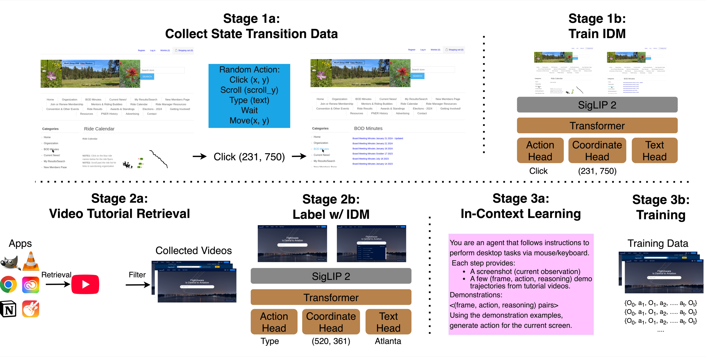
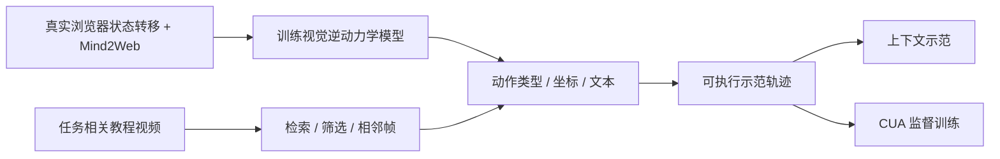

# Watch & Learn：视频到计算机操作轨迹

> 历史目录补漏：成本过高，不复现（审查 DONE）。本页没有可执行 adapter、组件指标或 GPU 通过声明，不进入自动实现/重试队列。

## 论文信息

| 字段 | 内容 |
|---|---|
| 论文链接 | [Watch and Learn: Learning to Use Computers from Online Videos](https://arxiv.org/abs/2510.04673v1) |
| 公司 / 机构 | 一作 Chan Hee Song：The Ohio State University；合作者来自 Google Cloud AI Research / Google DeepMind，见[作者项目页](https://chanh.ee/wandl/) |
| 首次公开日期 | **2025-10-06 10:29:00 UTC**，arXiv v1；本页方法/成本核对 v1。最新 v3 为 2026-03-16，不把该版本或 Google 新目录页当首次日期 |
| 原作者代码 | 未核验到作者代码/权重；项目页 `Code` 为无链接占位，不能视为已开源；代码 SHA / 许可不适用 |
| Adapter | catalog key `watch-and-learn`；`adapter=null` |
| 本地复现代码 | 无实现代码目录；仅 `src/auto_research/paper_specs/catalog/agent-research/watch-and-learn.json` 与本页审查材料 |
| 入库口径 | `historical-directory-backfill`；2026-10-26 观察到 Google 目录新增 URL，不是新论文首发 |

## 原始论文总结

### 背景与主要改动

W&L 把“视频里发生了什么操作”建模为逆动力学：输入前后两张屏幕图像，预测导致状态变化的动作。训练好的 IDM 再标注网络教程视频，结合任务检索形成轨迹，分别用于 CUA 的上下文示范和监督训练，而非直接让通用大模型猜动作或用规则恢复轨迹。

### 原论文关键图

<!-- paper-figure:start -->

图片来自[原论文](https://arxiv.org/html/2510.04673v1#S3)，版权归原作者所有。原图仅转换格式并等比缩小以便网页阅读；见 `assets/provenance.json`。

<!-- paper-figure:end -->

### 核心公式

$$
p_\theta(a_t\mid O_t,O_{t+1}),\qquad
\mathcal L=\mathcal L_{action}+\mathcal L_{coordinate}+\mathcal L_{text}.
$$

SigLIP-2 加四层 Transformer 编码图像；分类头预测动作，坐标离散为 0–1000，GPT-2 small 头生成输入文本。三项监督为动作/坐标交叉熵和文本自回归损失。原文未给出额外权重，本页不自行补造。推断出的动作再串成连续状态—动作轨迹。

### 论文离线与线上效果

固定 v1 Table 2 的 OSWorld 中，UI-TARS-7B 从 27.3% 到 31.1%，Qwen2.5-VL-7B 从 1.9% 到 13.0%；这些是原论文基线、数据和环境下的结果，不是本库重跑。未报告生产线上 A/B，真实桌面 benchmark 也不是线上流量实验。

## 本地复现

**成本过高，不复现（审查 DONE）**。固定 v1 §3.1/附录 D.3 使用超过 630k 状态转移，IDM 训练为 **8×A100 80GB、15 epochs**；另有 53,125 个视频轨迹、7B CUA SFT、联网检索/API 和真实 OSWorld 桌面评测。该配置明显超过单张 A100/A30 或本地 Mac 的短时预算；这是作者配置形成的成本判断，不是本地计时。

不下载语料或权重、不搭建桌面环境、不运行探针，不用规则动作或读取 gold 的 agent 替代 IDM/CUA。没有本地 metrics、命令或 GPU receipt；`requires_gpu_validation=false`、`gpu_validation_passed=false` 表示未接受实现，并非 CPU 验证过完整方法。审查完成与实验实现分开记录，不阻塞其他低成本组件。
